# The Lenny Growth Assistant

An enterprise-grade, retrieval-augmented intelligence system built to synthesize product management, growth strategy, and startup execution principles. The assistant ingests transcripts from **Lenny's Podcast** and user-uploaded PDF strategy documents into a high-dimensional vector space using **PostgreSQL + pgvector**, coordinates autonomous multi-role workflows through a deterministic intent router, and delivers answers, publishable Ship 30 for 30 digital writing, and interactive HTML/CSS UI prototypes through a unified chat interface with an automatic in-app Artifact Viewer.

---

## Table of Contents
1. [Project Overview](#1-project-overview)
2. [Complete System Architecture](#2-complete-system-architecture)
3. [Repository and Module Structure](#3-repository-and-module-structure)
4. [Data Ingestion Architecture](#4-data-ingestion-architecture)
5. [Transcript Processing Pipeline](#5-transcript-processing-pipeline)
6. [PDF Upload and Processing Pipeline](#6-pdf-upload-and-processing-pipeline)
7. [Chunking Strategy](#7-chunking-strategy)
8. [Embedding Generation](#8-embedding-generation)
9. [PostgreSQL and pgvector Schema](#9-postgresql-and-pgvector-schema)
10. [Vector Indexing and Similarity Search](#10-vector-indexing-and-similarity-search)
11. [Query-Time RAG Pipeline](#11-query-time-rag-pipeline)
12. [Intent Router and Three Agent Workflows](#12-intent-router-and-three-agent-workflows)
13. [LLM Provider Routing](#13-llm-provider-routing)
14. [Prompt Assembly, Grounding, and Citations](#14-prompt-assembly-grounding-and-citations)
15. [Artifact Generation and Artifact Viewer](#15-artifact-generation-and-artifact-viewer)
16. [Security Architecture](#16-security-architecture)
17. [Step-by-Step Windows Setup](#17-step-by-step-windows-setup)
18. [API Endpoints and Data Contracts](#18-api-endpoints-and-data-contracts)
19. [Testing and Validation](#19-testing-and-validation)
20. [Troubleshooting](#20-troubleshooting)
21. [Configuration Reference](#21-configuration-reference)
22. [End-to-End Examples](#22-end-to-end-examples)
23. [Known Limitations and Future Improvements](#23-known-limitations-and-future-improvements)

---

## 1. Project Overview

The Lenny Growth Assistant bridges the gap between static unstructured knowledge repositories (podcast audio transcripts, executive PDFs) and actionable operational workflows. The platform addresses three distinct modes of interaction:
1. **RAG Research & Fact Retrieval**: Grounded answers extracted from 33 indexed episodes (7,023 semantic chunks) of Lenny's Podcast and user-uploaded documents, backed by verbatim citations and timestamps.
2. **Ship 30 for 30 Atomic Writing**: Digital writing transformation converting raw insights into structured atomic essays, framework breakdowns, and actionable guides using the 1-3-1 methodology (Headline/Hook, Reader Friction, Focused Thesis, 3–4 Structured Body Points, Actionable Takeaway).
3. **Artifact Generation & Interactive Preview**: Autonomous generation of standalone Markdown strategy reports and sandboxed HTML/CSS user interface prototypes (analytics dashboards, landing pages, pricing calculators) displayed automatically inside an integrated Artifact Viewer.

The platform eliminates modal fragmentation: users interact through **ONE unified chat input**. A deterministic backend intent router analyzes user intent, checks session state, coordinates internal agent execution, and selects the appropriate model provider (local offline Ollama vs. cloud Anthropic Claude).

---

## 2. Complete System Architecture

The following diagram illustrates the verified end-to-end component topology and runtime data flow:

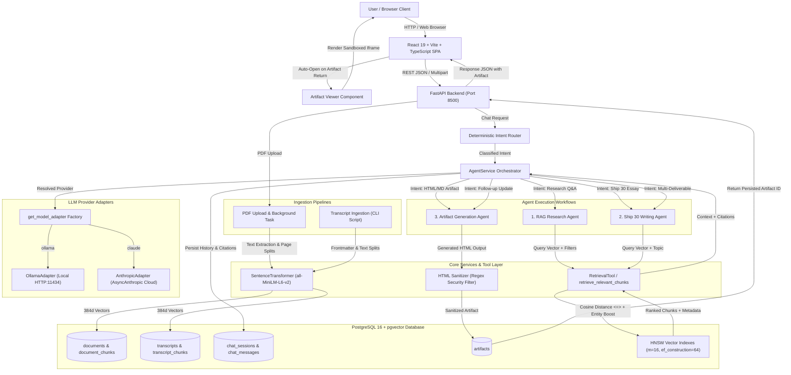

### Component Breakdown
1. **User / Browser Client**: Desktop or mobile browser accessing the single-page application at `http://localhost:5173`.
2. **React SPA**: React 19, TypeScript, Tailwind CSS, Lucide icons, and Radix UI components providing sidebar session management, document upload controls, provider selection dropdown, and chat stream rendering.
3. **FastAPI Application**: Asynchronous REST service running under Uvicorn at `http://127.0.0.1:8500`, exposing endpoints for messaging, document ingestion, session history, provider discovery, and health monitoring.
4. **Intent Router (`IntentRouter`)**: Deterministic priority-ordered classification engine evaluating user queries, conversation history, and active session artifacts to route requests to the correct agent workflow without requiring manual user mode switching.
5. **Agent Service (`AgentService`)**: Central orchestrator coordinating session persistence, tool execution, model adapter resolution, response synthesis, artifact persistence, and citation mapping.
6. **Agent Execution Workflows**: Three specialized internal workflows:
   - *RAG Research Agent*: Grounded QA over podcast transcripts and documents.
   - *Ship 30 for 30 Writing Agent*: Evidence-grounded atomic digital essay synthesis.
   - *Artifact Generation Agent*: Production-grade Markdown strategy documents and standalone HTML/CSS UI mockups with multi-turn in-place updates.
7. **Ingestion Pipelines**:
   - `ingest_transcripts.py`: Standalone CLI tool fetching remote markdown transcripts from GitHub, parsing YAML frontmatter, chunking text, generating batched embeddings, and storing records.
   - `documents.py`: FastAPI background task pipeline reading uploaded PDFs via PyMuPDF, extracting page boundaries, chunking, generating embeddings, and updating status flags.
8. **SentenceTransformer Service**: Local embedding generator loading `sentence-transformers/all-MiniLM-L6-v2` to produce 384-dimensional dense float vectors.
9. **Retrieval Tool (`RetrievalTool` / `retrieve_relevant_chunks`)**: Hybrid retrieval engine performing pgvector cosine distance similarity search (`<=>`), guest entity matching, and keyword-boosted ranking.
10. **PostgreSQL 16 + pgvector**: Relational storage engine with native vector extensions, hosting HNSW vector indexes (`m=16`, `ef_construction=64`, `vector_cosine_ops`), foreign key cascading constraints, and JSONB citation storage.
11. **Model Provider Adapters**: Decoupled interface (`BaseModelAdapter`) with concrete implementations:
    - `OllamaAdapter`: Direct HTTP communication with local Ollama (`qwen3:4b`).
    - `AnthropicAdapter`: Official `anthropic.AsyncAnthropic` SDK communication with Claude (`claude-3-5-sonnet-20241022`).
12. **HTML Sanitizer**: Multi-pass regex security filter stripping `<script>` tags, inline event handlers (`onclick`, `onload`), `javascript:` URLs, external stylesheets, and dangerous framing tags.
13. **Artifact Viewer**: In-app split/drawer pane featuring an isolated `<iframe sandbox="" />` preview with strict Content Security Policy enforcement, code view toggling, and export functionality.

---

## 3. Repository and Module Structure

```text
Lenny-Growth-Assistant/
├── docker-compose.yml              # PostgreSQL + pgvector container definition
├── README.md                       # Deep architectural technical documentation
├── PRD.md                          # Product requirements document
├── backend/
│   ├── alembic/                    # Database migration environment
│   │   ├── env.py                  # Alembic migration runner
│   │   └── versions/               # Versioned migration scripts
│   │       ├── 3320addd33e2_initial_schema_for_rag.py
│   │       ├── 08208aec05dc_add_document_models_for_pdf_uploads.py
│   │       ├── 03383e008969_add_citations_to_chat_messages.py
│   │       └── 51cb65ba7a87_add_artifacts_table.py
│   ├── alembic.ini                 # Alembic configuration file
│   ├── requirements.txt            # Python dependencies (pinned versions)
│   ├── .env.example                # Safe environment variable configuration template
│   ├── app/
│   │   ├── main.py                 # FastAPI application factory and CORS middleware
│   │   ├── core/
│   │   │   └── config.py           # Pydantic Settings (environment loading)
│   │   ├── db/
│   │   │   ├── base.py             # Declarative SQLAlchemy Base
│   │   │   └── session.py          # Engine and SessionLocal factory
│   │   ├── models/                 # SQLAlchemy 2.0 ORM models
│   │   │   ├── chat.py             # ChatSession, ChatMessage, MessageRole enum
│   │   │   ├── transcript.py       # Transcript, TranscriptChunk (pgvector)
│   │   │   ├── document.py         # Document, DocumentChunk (pgvector)
│   │   │   └── artifact.py         # Artifact (Markdown and HTML storage)
│   │   ├── repositories/           # Database access layer
│   │   │   ├── chat.py             # ChatRepository (sessions, messages)
│   │   │   ├── transcript.py       # TranscriptRepository (ingestion, lookup)
│   │   │   ├── document.py         # DocumentRepository (PDF records, chunks)
│   │   │   └── artifact.py         # ArtifactRepository (CRUD, in-place updates)
│   │   ├── schemas/                # Pydantic validation schemas
│   │   │   └── health.py           # HealthStatus schema
│   │   ├── services/               # Core business and AI services
│   │   │   ├── document.py         # PDF text extraction, hashing, chunking, embeddings
│   │   │   ├── retrieval.py        # Hybrid similarity search and entity matching
│   │   │   └── agent/              # Autonomous agent architecture
│   │   │       ├── router.py       # Deterministic IntentRouter and AgentIntent enum
│   │   │       ├── service.py      # AgentService orchestration core
│   │   │       ├── types.py        # Citation, RetrievalResult, AgentResponse
│   │   │       ├── tools.py        # RetrievalTool contract wrapper
│   │   │       ├── adapters.py     # BaseModelAdapter, OllamaAdapter, AnthropicAdapter
│   │   │       ├── skills/         # Specialized agent skills
│   │   │       │   ├── types.py    # WritingSkillInput, WritingSkillResult
│   │   │       │   └── ship30_writing.py # Ship 30 for 30 digital writing engine
│   │   │       └── artifacts/      # Standalone artifact generation engine
│   │   │           ├── types.py    # ArtifactGenerationInput, ArtifactGenerationResult
│   │   │           └── generator.py# ArtifactGenerator, HTML sanitizer, title extraction
│   │   └── api/                    # REST API routers
│   │       ├── main.py             # Aggregated /api/v1 router
│   │       ├── routes/
│   │       │   └── health.py       # GET /api/v1/health
│   │       ├── chat.py             # POST /api/v1/chat/message, sessions, artifacts
│   │       └── documents.py        # POST /api/v1/documents/upload, list, delete
│   ├── scripts/                    # Operational and ingestion scripts
│   │   ├── ingest_transcripts.py   # CLI ingestion for GitHub podcast transcripts
│   │   └── setup_test_db.py        # Test database bootstrap utility
│   └── tests/                      # Automated pytest test suite (65 tests)
│       ├── conftest.py             # Database fixtures and mock session factories
│       ├── test_unified_intent_routing.py # 16 mandatory regression scenarios
│       ├── test_agent_service.py   # AgentService chat orchestration tests
│       ├── test_agent_tools.py     # RetrievalTool unit tests
│       ├── test_artifacts.py       # Artifact generation, persistence, sanitation tests
│       ├── test_chat_api.py        # Chat API endpoint tests
│       ├── test_claude_provider.py # Claude adapter and provider switching tests
│       ├── test_documents.py       # PDF upload and processing tests
│       ├── test_health.py          # Health check endpoint tests
│       ├── test_repositories.py    # Database repositories tests
│       └── test_ship30_writing.py  # Ship 30 writing methodology tests
├── frontend/
│   ├── package.json                # Frontend dependencies and Vite scripts
│   ├── vite.config.ts              # Vite configuration (port 5173, proxy)
│   ├── tsconfig.json               # TypeScript compiler configuration
│   ├── src/
│   │   ├── main.tsx                # React entry point
│   │   ├── App.tsx                 # Core App component: state, layout, unified chat
│   │   ├── types/
│   │   │   └── index.ts            # Frontend TypeScript contracts
│   │   ├── services/
│   │   │   └── api.ts              # Fetch client for backend REST endpoints
│   │   ├── components/
│   │   │   ├── chat/
│   │   │   │   ├── ChatMessage.tsx # Message bubble, role attribution, citation cards
│   │   │   │   ├── MessageComposer.tsx # Single unified chat input box
│   │   │   │   ├── WelcomeScreen.tsx   # Initial greeting and suggested prompt cards
│   │   │   │   ├── DocumentUploader.tsx# PDF upload and status indicators
│   │   │   │   └── SourceCitation.tsx  # Verbatim quote and episode reference cards
│   │   │   ├── artifacts/
│   │   │   │   └── ArtifactViewer.tsx  # Split pane with Sandboxed iframe & code view
│   │   │   ├── layout/
│   │   │   │   ├── AppSidebar.tsx      # Chat session history and settings toggle
│   │   │   │   ├── ProviderSelector.tsx# Header model toggle (Ollama vs. Claude)
│   │   │   │   └── SettingsDialog.tsx  # Provider credentials & connection status
│   │   │   └── ui/                     # Reusable shadcn/ui primitives
│   │   └── App.test.tsx            # Vitest UI tests (unified chat & artifact viewer)
└── docs/                           # Authoritative engineering reports
    ├── unified_agent_chat_and_artifact_viewer_report.md # Final unification audit
    ├── claude_provider_integration_report.md            # Claude integration audit
    └── three_agent_integration_audit.md                 # Three-agent baseline audit
```

---

## 4. Data Ingestion Architecture

The Lenny Growth Assistant supports two ingestion pipelines designed for distinct knowledge sources:

| Property | Transcript Ingestion Pipeline | PDF Upload Ingestion Pipeline |
| :--- | :--- | :--- |
| **Source Type** | Remote GitHub repository Markdown files | User-uploaded local PDF files |
| **Trigger Mechanism** | Manual CLI execution (`ingest_transcripts.py`) | User upload via REST API (`POST /api/v1/documents/upload`) |
| **Execution Mode** | Synchronous batch script | Asynchronous FastAPI `BackgroundTasks` |
| **Format Parsing** | YAML Frontmatter extraction + Markdown cleanup | PyMuPDF (`fitz`) page-by-page text stream |
| **Chunking Logic** | `RecursiveCharacterTextSplitter` across body | `RecursiveCharacterTextSplitter` bounded per page |
| **Chunk Size & Overlap** | 700 characters / 100 characters overlap | 700 characters / 100 characters overlap |
| **Metadata Preserved** | `source_key`, `title`, `source_url`, `source_path`, speaker timestamps | `filename`, `page_number`, `document_id` |
| **Embedding Call** | Batched (`EMBED_BATCH_SIZE = 64`) | Single batch across all document chunks |
| **Duplicate Prevention** | SHA-256 hash of cleaned text body | SHA-256 hash of entire raw binary file |
| **Persistence Target** | `transcripts` & `transcript_chunks` tables | `documents` & `document_chunks` tables |

---

## 5. Transcript Processing Pipeline

Transcripts are ingested from the public repository [`ChatPRD/lennys-podcast-transcripts`](https://github.com/ChatPRD/lennys-podcast-transcripts). The pipeline is invoked via `backend/scripts/ingest_transcripts.py`.

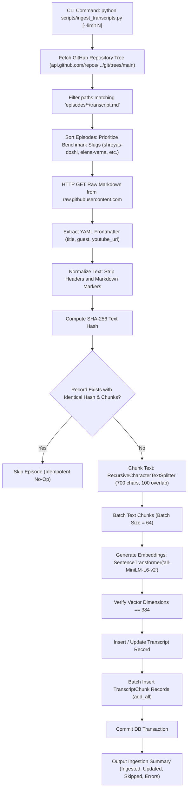

### Transcript Pipeline Details:
- **Invocation**: Manual via `python scripts/ingest_transcripts.py --limit 35`.
- **Benchmark Prioritization**: The script hardcodes priority for critical evaluation episodes (`shreyas-doshi-live`, `shreyas-doshi`, `krithika-shankarraman`, `brian-chesky`, `elena-verna`).
- **Timestamp Preservation**: Speaker lines and timestamps embedded in the transcript text (e.g., `Shreyas Doshi (05:39): ...`) are preserved during text cleaning and remain embedded inside the chunk content, enabling citation timestamps.
- **Idempotency**: Before processing, the script computes `compute_text_hash(body)` and checks `TranscriptRepository.get_transcript_by_source(source_key)`. If the record exists with identical hash and existing chunks, it is skipped.
- **Update Handling**: If an episode exists with an altered hash, existing chunks are deleted via `DELETE FROM transcript_chunks WHERE transcript_id = :id` and replaced with newly chunked embeddings.

---

## 6. PDF Upload and Processing Pipeline

PDF ingestion allows users to ground answers in proprietary company documents, strategy guides, and PRDs.

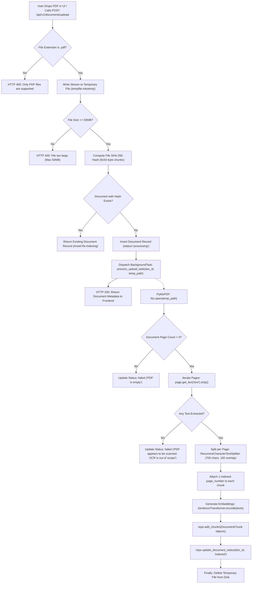

### PDF Pipeline Details:
- **Endpoint**: `POST /api/v1/documents/upload` accepting multipart form data (`file: UploadFile`).
- **File Restrictions**: Must end with `.pdf` (case-insensitive); strictly capped at `50MB` (`52,428,800 bytes`).
- **Duplicate Detection**: Computes SHA-256 over 8192-byte binary buffers. If a document matches an existing `content_hash`, the backend returns the existing record immediately without re-indexing.
- **Scanned PDF Handling**: PyMuPDF extracts text streams via `page.get_text("text")`. If zero text is recovered across all pages, the pipeline fails safely with: `"PDF appears to be scanned or contains no extractable text. OCR is out of scope."`
- **Asynchronous Execution**: Ingestion runs inside a dedicated FastAPI `BackgroundTasks` thread pool. The frontend polls `GET /api/v1/documents` until `status == "indexed"`.

---

## 7. Chunking Strategy

Text chunking divides continuous prose into discrete semantic units that balance contextual richness against retrieval precision.

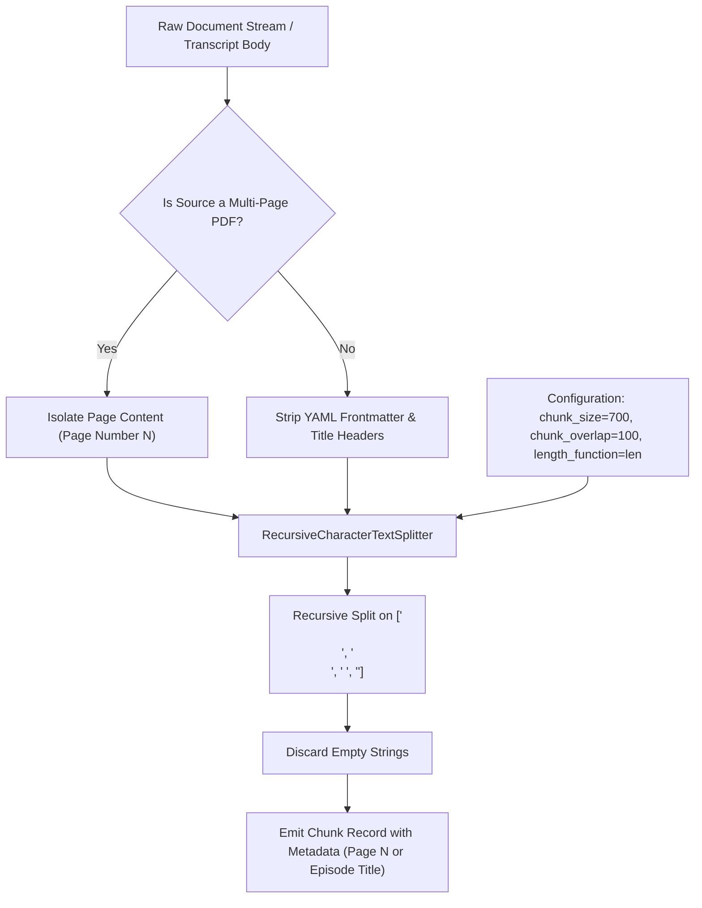

### Verified Chunking Parameters

| Property | PDF Chunking Specification | Transcript Chunking Specification |
| :--- | :--- | :--- |
| **Implementation** | `langchain_text_splitters.RecursiveCharacterTextSplitter` | `langchain_text_splitters.RecursiveCharacterTextSplitter` |
| **Configured Chunk Size** | `700` | `700` |
| **Size Unit** | **Characters** (defined by Python `length_function=len`) | **Characters** (defined by Python `length_function=len`) |
| **Configured Overlap** | `100` | `100` |
| **Overlap Unit** | **Characters** | **Characters** |
| **Default Separators** | `["\n\n", "\n", " ", ""]` | `["\n\n", "\n", " ", ""]` |
| **Page Boundary Rule** | **Strict Isolation**: Chunking loops per page; a chunk never spans across multiple pages | **Continuous Prose**: Chunking splits across the entire episode transcript body |
| **Speaker Preservation** | N/A (Standard prose) | Preserved: Speaker labels (e.g., `Shreyas Doshi (05:39):`) remain embedded |
| **Empty Chunks** | Stripped automatically by splitter | Stripped automatically; episodes `< 100` chars skipped |
| **Metadata Attached** | `document_id`, `chunk_index`, `page_number` | `transcript_id`, `chunk_index` |

### Why Chunk Overlap Exists
Without overlap, semantic context split across boundary cuts can cause retrieval failures. For example, if a key metric sentence begins at character 690 and finishes at character 740, splitting without overlap places half the sentence in chunk 1 and half in chunk 2. With **100-character overlap**, characters 600–700 of Chunk 1 are duplicated at the start of Chunk 2, preserving continuity.

### Illustrative Worked Example
*(Hypothetical 200-character chunk size with 40-character overlap for visualization)*

```text
Original Text:
"Product-market fit is when customers pull your product. Retention is the single best measure of PMF because it proves continued value delivery over time."

Chunk 1 (Characters 0 - 100):
[Product-market fit is when customers pull your product. Retention is the single best measure of PMF]

Chunk 2 (Characters 60 - 150 - Overlaps characters 60-100 of Chunk 1):
[Retention is the single best measure of PMF because it proves continued value delivery over time.]
```

---

## 8. Embedding Generation

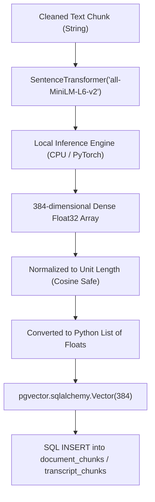

### Embedding Specifications:
- **Model Identifier**: `sentence-transformers/all-MiniLM-L6-v2` (loaded via HuggingFace Hub cache).
- **Execution Target**: Local machine (CPU or CUDA if configured). Zero external API calls.
- **Embedding Dimensions**: **384 dimensions**.
- **Vector Storage Type**: `pgvector.sqlalchemy.Vector(384)` mapped to PostgreSQL native `vector(384)`.
- **Batching Strategy**:
  - Transcripts: Batched in groups of `64` chunks (`EMBED_BATCH_SIZE = 64`).
  - PDFs: Encoded in a single batch passing all chunks for the document.
  - Queries: Single-element batch: `embed_texts([clean_question])[0]`.

---

## 9. PostgreSQL and pgvector Schema

The database schema is managed via Alembic migrations.

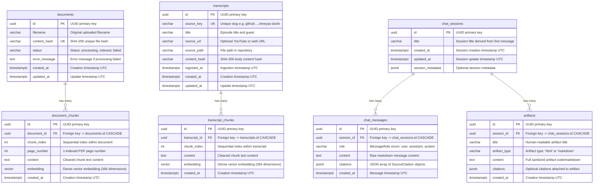

### Relational Integrity & Constraints:
- **Foreign Keys**: All chunk, message, and artifact tables reference parent tables with `ON DELETE CASCADE`. Deleting a session deletes all messages and artifacts. Deleting a document deletes its chunks.
- **Unique Constraints**:
  - `uq_document_chunk_index`: Unique on `(document_id, chunk_index)`.
  - `uq_transcript_chunk_index`: Unique on `(transcript_id, chunk_index)`.
  - `ix_documents_content_hash`: Unique index on `documents.content_hash`.
  - `ix_transcripts_source_key`: Unique index on `transcripts.source_key`.

---

## 10. Vector Indexing and Similarity Search

### HNSW Index Configuration
Both `transcript_chunks` and `document_chunks` utilize **Hierarchical Navigable Small World (HNSW)** indexes configured via Alembic migrations:

```sql
CREATE INDEX ix_transcript_chunks_embedding 
ON transcript_chunks 
USING hnsw (embedding vector_cosine_ops) 
WITH (m = 16, ef_construction = 64);

CREATE INDEX ix_document_chunks_embedding 
ON document_chunks 
USING hnsw (embedding vector_cosine_ops) 
WITH (m = 16, ef_construction = 64);
```

- **Index Operator Class**: `vector_cosine_ops` (optimizes cosine distance search).
- **HNSW `m` Parameter (16)**: Max number of bidirectional links created per vector node.
- **HNSW `ef_construction` (64)**: Size of the dynamic candidate list evaluated during index construction.
- **Distance Operator**: `<=>` (Cosine Distance, where `Distance = 1.0 - CosineSimilarity`). Smaller distance represents greater semantic similarity.

---

## 11. Query-Time RAG Pipeline

When a user submits a question, the application executes a hybrid retrieval and ranking pipeline:

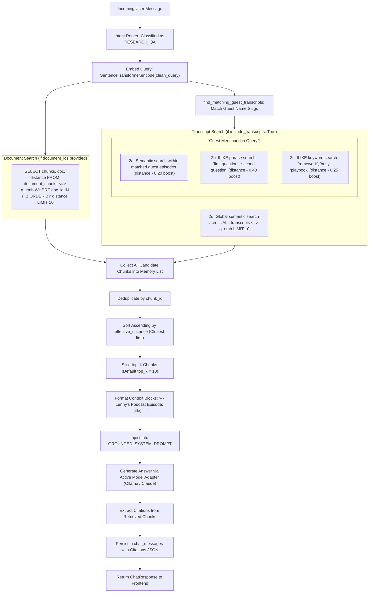

### Retrieval Algorithm Explained:
1. **Query Embedding**: Converts the cleaned query text into a 384-dimensional dense vector.
2. **Document Partition**: If `document_ids` are selected, queries `document_chunks` using `distance = DocumentChunk.embedding.cosine_distance(question_embedding)`.
3. **Entity-Aware Guest Matching**: `find_matching_guest_transcripts()` scans query tokens against episode slugs (e.g., `"shreyas"`, `"doshi"`, `"verna"`, `"chesky"`).
4. **Keyword & Ordinal Distance Boosting**:
   - Chunks from matched episodes receive an effective distance discount (`distance - 0.20`).
   - High-precision ordinal phrases (e.g., `"first question"`, `"second question"`) receive a **-0.40 distance discount**.
   - Keyword matches (e.g., `"busy"`, `"framework"`) receive a **-0.25 distance discount**.
5. **Global Semantic Search**: Executes a standard global cosine search across all 7,023 chunks to ensure relevant episodes outside of explicit guest names are surfaced.
6. **Deduplication & Sorting**: Merges all candidate pools, eliminates duplicates by `chunk_id`, sorts ascending by `effective_distance`, and takes the top 10 chunks.

> [!NOTE]
> **Generation Top-K vs. Retrieval Top-K:**
> - **Retrieval Top-K (`AGENT_TOP_K = 10`)**: The number of evidence chunks retrieved from pgvector to build context.
> - **Generation Top-K**: An optional model sampling parameter controlling the token probability pool during inference, supported by Ollama.

---

## 12. Intent Router and Three Agent Workflows

The deterministic `IntentRouter` (`backend/app/services/agent/router.py`) evaluates requests prior to agent execution, enforcing priority rules:

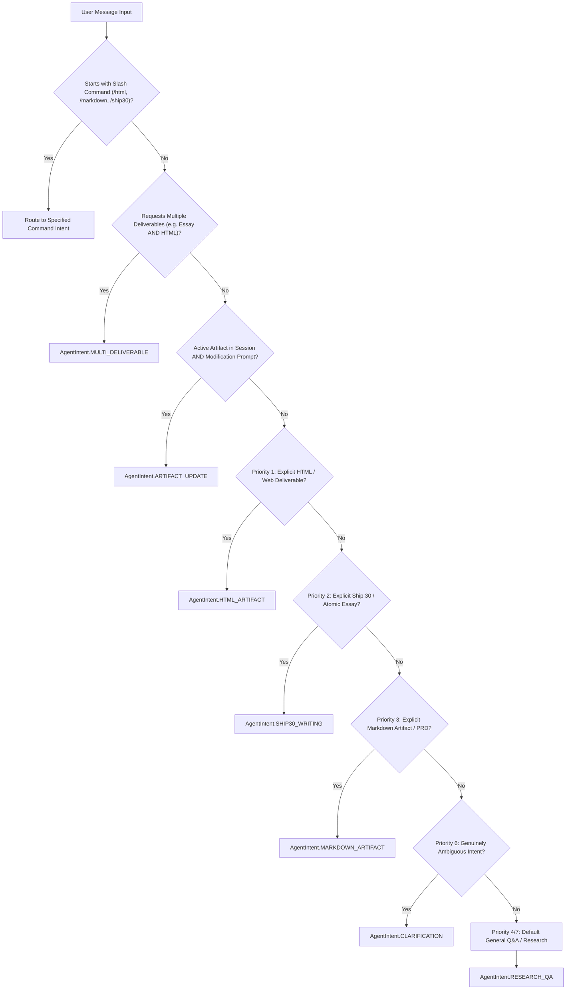

### The Three Internal Agent Roles:

#### 1. RAG Research Agent
- **Responsibility**: Factual synthesis, concept explanations, and podcast Q&A.
- **Workflow**: Invokes `RetrievalTool`, embeds evidence into `GROUNDED_SYSTEM_PROMPT`, generates text response, and attaches structured `SourceCitation` objects.

#### 2. Ship 30 for 30 Writing Agent
- **Responsibility**: Digital writing transformation converting rough topics into structured atomic essays.
- **Workflow**: Invokes `RetrievalTool` with `include_transcripts=True` when grounded research is needed. Assembles the `<evidence>` block into `SHIP30_SYSTEM_PROMPT`. Generates punchy headline, reader friction, single-sentence thesis, 3–4 structured body points, and an actionable conclusion. Returns essay directly in chat.

#### 3. Artifact Generation Agent
- **Responsibility**: Standalone production documents (Markdown reports) and interactive UI mockups (HTML/CSS).
- **Workflow**: Generates self-contained HTML/CSS using `HTML_SYSTEM_PROMPT` or structured reports using `MARKDOWN_SYSTEM_PROMPT`. Runs server-side sanitization, saves to PostgreSQL `artifacts` table, and returns the real artifact ID. The frontend automatically opens the in-app **Artifact Viewer**.

---

## 13. LLM Provider Routing

The application provides dynamic, per-request switching between local offline execution and cloud execution:

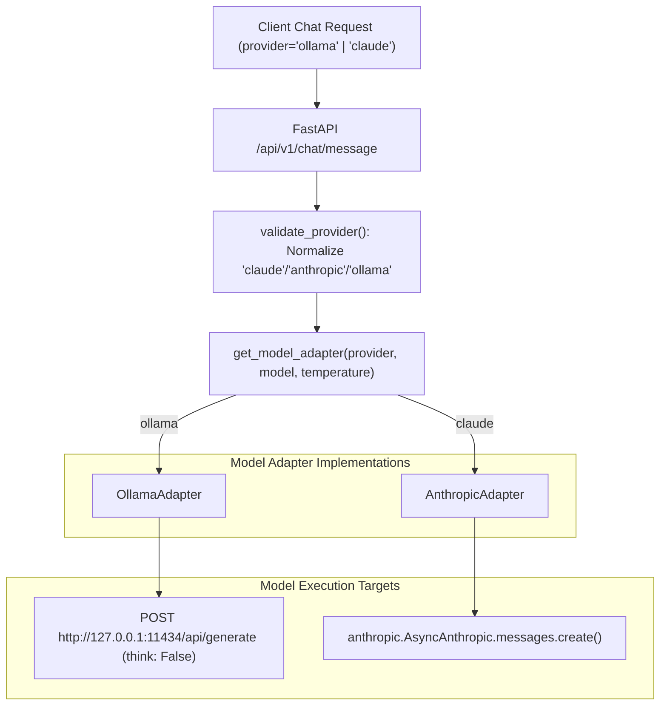

### Provider Details:
- **OllamaAdapter**:
  - Connects to local endpoint `http://127.0.0.1:11434/api/generate`.
  - Default model: `qwen3:4b`.
  - Passes `"think": False` to disable internal Qwen3 thinking loops that would otherwise exhaust prediction token budgets.
- **AnthropicAdapter**:
  - Connects to `https://api.anthropic.com/v1/messages` using `anthropic.AsyncAnthropic`.
  - Default model: `claude-3-5-sonnet-20241022`.
  - Maps `temperature` (clamped `0.0–1.0`) and `top_p`.
  - Maps errors (`AuthenticationError`, `RateLimitError`, `APITimeoutError`) to descriptive user notifications.
- **Attribution**: Stored on `chat_messages` and returned in `ChatResponse` (e.g. `Ollama Local · qwen3:4b` or `Claude Cloud · claude-3-5-sonnet-20241022`).

---

## 14. Prompt Assembly, Grounding, and Citations

### Grounded System Prompt (`GROUNDED_SYSTEM_PROMPT`)
```text
You are the Lenny Growth Assistant, an AI expert in product management, growth, and startups.
Your answers MUST be strictly grounded in the provided context from Lenny's Podcast transcripts and uploaded documents.

CRITICAL GROUNDING RULES:
1. Base your response ONLY on the provided excerpts.
2. For each key claim or fact, cite the specific source (e.g. [Episode Title] or [Filename, Page X]).
3. If the provided excerpts do not contain sufficient evidence to answer the question, clearly state:
   "The provided sources do not contain sufficient evidence to answer this question."
4. NEVER fabricate, hallucinate, or assume facts, page numbers, quotes, or sources not present in the excerpts.
5. If providing general product context beyond the sources, explicitly distinguish it as general knowledge not supported by the excerpt text.
```

### Context Block Assembly Format
When evidence chunks are passed into the prompt, they are enclosed with distinct source headers:
```text
Context from Lenny's Podcast Transcripts & Uploaded Documents:

--- Lenny's Podcast Episode: The art of product management | Shreyas Doshi (Stripe, Twitter, Google, Yahoo) ---
Shreyas Doshi (05:39): Right, so let's see, the first question is why am I so busy? ...

--- Document: q3_growth_review.pdf (Page 4) ---
Product-led growth loops compound retention and viral acquisition...

User Question: Why did Shreyas Doshi say he was so busy in his career?

Provide a thorough, grounded answer citing specific sources, episode titles, or pages:
```

---

## 15. Artifact Generation and Artifact Viewer

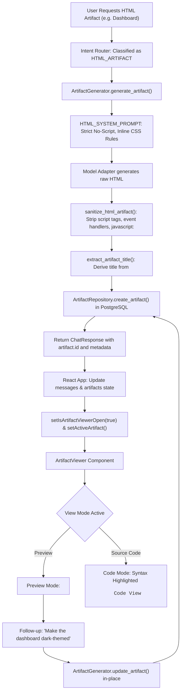

### Features of the Artifact Lifecycle:
1. **Automatic Opening**: Returning an artifact automatically opens the viewer (`setIsArtifactViewerOpen(true)`).
2. **In-Place Multi-Turn Updates**: Follow-up modification requests (e.g. *"Change the dashboard to a dark theme"*, *"Add a retention chart"*) resolve the active session artifact, update the content in-place in PostgreSQL, and refresh the active preview without duplicating records or breaking conversation history.
3. **Truthful Error Handling**: If database persistence fails, the assistant returns an explicit error message and sets `artifact=None`. The system never fabricates an artifact ID.

---

## 16. Security Architecture

The platform enforces multi-layered isolation for untrusted model-generated HTML:

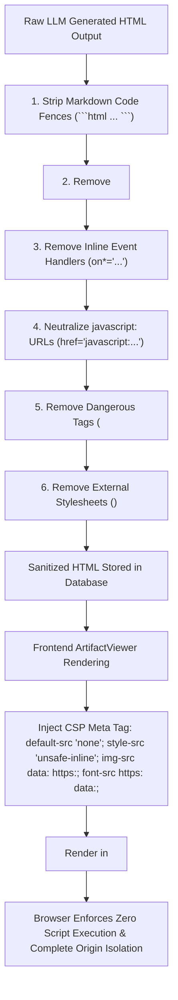

### Verified Security Controls:
1. **Server-Side Sanitizer (`sanitize_html_artifact`)**:
   - Strips `<script[\s\S]*?</script>`.
   - Strips inline event handlers (`onclick`, `onload`, `onerror`, `onmouseover`).
   - Replaces `href="javascript:..."` with `href="#"`.
   - Removes `<iframe>`, `<object>`, `<embed>`, `<applet>`, and `<meta http-equiv="refresh">`.
   - Removes external `<link rel="stylesheet">` tags.
2. **Iframe Sandbox Boundary**:
   - The iframe is configured with `sandbox=""` (empty string).
   - This prevents script execution, plugin execution, form submissions, and popups.
3. **Content Security Policy**:
   - Injected directly into the document `<head>`:
     ```html
     <meta http-equiv="Content-Security-Policy" content="default-src 'none'; style-src 'unsafe-inline'; img-src data: https:; font-src https: data:;">
     ```
4. **Parent Application Isolation**:
   - The sandboxed document has zero access to `window.localStorage`, cookies, parent DOM elements, or backend credentials.

---

## 17. Step-by-Step Windows Setup

Follow this step-by-step PowerShell guide to start the project on Windows.

### Prerequisites
- Windows 10/11 with PowerShell.
- Docker Desktop installed and running.
- Python 3.11 or 3.12 installed.
- Node.js 20+ installed.
- Ollama installed.

---

### Step 1: Start External Services (Database & Local LLM)

Open **PowerShell** and start the database container:
```powershell
docker compose up -d db
```
Verify the container is healthy:
```powershell
docker ps --filter "name=lenny-rag-db"
```

Start Ollama and verify the default model:
```powershell
ollama pull qwen3:4b
ollama run qwen3:4b
```
*(You can exit the interactive Ollama prompt with `/bye`; the service remains running in the background).*

---

### Step 2: Configure Environment & Start Backend (Terminal 1)

1. Navigate to the backend directory:
   ```powershell
   cd D:\project\Lenny-Growth-Assistant\backend
   ```
2. Verify or create `.env` from template:
   ```powershell
   if (!(Test-Path .env)) { Copy-Item .env.example .env }
   ```
3. Activate the virtual environment:
   ```powershell
   .\venv\Scripts\Activate.ps1
   ```
4. *(First-time setup only)* Apply database migrations:
   ```powershell
   alembic upgrade head
   ```
5. *(First-time setup only)* Ingest Lenny's Podcast transcripts:
   ```powershell
   python scripts\ingest_transcripts.py --limit 35
   ```
6. Start the FastAPI development server:
   ```powershell
   uvicorn app.main:app --host 127.0.0.1 --port 8500 --reload
   ```
   *Verify backend health in browser: [http://127.0.0.1:8500/api/v1/health](http://127.0.0.1:8500/api/v1/health).*

---

### Step 3: Start the Frontend (Terminal 2)

Open a **second PowerShell window**:
1. Navigate to the frontend directory:
   ```powershell
   cd D:\project\Lenny-Growth-Assistant\frontend
   ```
2. Install dependencies:
   ```powershell
   npm install
   ```
3. Start the Vite development server:
   ```powershell
   npm run dev
   ```
4. Open the application: Navigate to **[http://localhost:5173](http://localhost:5173)**.

---

## 18. API Endpoints and Data Contracts

All endpoints are prefixed with `/api/v1`.

### 1. Health & Discovery
- `GET /api/v1/health`
  - **Purpose**: Verify API status and PostgreSQL database connection.
  - **Response**: `{"status": "ok", "database": "ok"}`
- `GET /api/v1/chat/providers`
  - **Purpose**: List available model providers (Ollama vs. Claude) and configuration status.
  - **Response**:
    ```json
    {
      "active_provider": "ollama",
      "providers": [
        {"id": "ollama", "name": "Ollama (Local)", "model": "qwen3:4b", "available": true},
        {"id": "claude", "name": "Claude AI (Cloud)", "model": "claude-3-5-sonnet-20241022", "available": false}
      ]
    }
    ```

### 2. Chat & Messaging
- `POST /api/v1/chat/message`
  - **Purpose**: Unified interaction endpoint for Q&A, writing, and artifact generation.
  - **Request Body**:
    ```json
    {
      "content": "Create an HTML dashboard for my startup",
      "session_id": "optional-uuid",
      "document_ids": [],
      "provider": "ollama",
      "model": "qwen3:4b",
      "temperature": 0.0
    }
    ```
  - **Response Body**:
    ```json
    {
      "session_id": "246699b9-21ef-4386-a5d7-cf1e975399f3",
      "response": {
        "id": "uuid",
        "role": "assistant",
        "content": "I have created the **Product Analytics Dashboard** (HTML) artifact for you!",
        "citations": null,
        "provider": "ollama",
        "model": "qwen3:4b"
      },
      "artifact": {
        "id": "ae00a9f9-72d6-4840-ad14-0f617b902d6c",
        "session_id": "246699b9-21ef-4386-a5d7-cf1e975399f3",
        "title": "Product Analytics Dashboard",
        "artifact_type": "html",
        "content": "<!DOCTYPE html><html>...",
        "citations": null
      },
      "provider": "ollama",
      "model": "qwen3:4b"
    }
    ```

### 3. Session & Artifact History
- `GET /api/v1/chat/sessions`: List all chat sessions ordered by `updated_at DESC`.
- `GET /api/v1/chat/sessions/{session_id}/messages`: Retrieve message history and citations for a session.
- `GET /api/v1/chat/sessions/{session_id}/artifacts`: Retrieve all artifacts created in a session.
- `GET /api/v1/chat/artifacts/{artifact_id}`: Retrieve a specific artifact by unique ID.

### 4. Document Management
- `POST /api/v1/documents/upload`: Upload PDF (multipart/form-data), returns `DocumentResponse`.
- `GET /api/v1/documents/`: List all uploaded documents with processing status (`processing`, `indexed`, `failed`).
- `DELETE /api/v1/documents/{document_id}`: Delete a document and its cascading chunks.

---

## 19. Testing and Validation

### Running the Backend Pytest Suite
Execute all 65 automated tests using the virtual environment:
```powershell
cd D:\project\Lenny-Growth-Assistant\backend
.\venv\Scripts\python.exe -m pytest tests/ -v
```

#### Test Coverage Breakdown:
- `tests/test_unified_intent_routing.py` (16 tests): Tests all 16 mandatory regression scenarios including routing priority, HTML dashboard isolation, multi-deliverables, follow-up updates, persistence failure handling, and security.
- `tests/test_agent_service.py` (6 tests): AgentService session handling, citations, and grounded answer tests.
- `tests/test_agent_tools.py` (5 tests): RetrievalTool execution, transcript flags, and chunk mapping.
- `tests/test_artifacts.py` (7 tests): Artifact generation, HTML sanitization, and title extraction.
- `tests/test_chat_api.py` (4 tests): Chat API routing and citation serialization.
- `tests/test_claude_provider.py` (11 tests): Provider validation, factory resolution, and Claude error handling.
- `tests/test_documents.py` (2 tests): PDF extraction, hashing, and chunking.
- `tests/test_health.py` (2 tests): Database health check endpoint tests.
- `tests/test_repositories.py` (3 tests): Database CRUD operations and pgvector embedding dimensions.
- `tests/test_ship30_writing.py` (8 tests): Ship 30 writing methodology, grounding, and formatting styles.
- `tests/test_ollama_live.py` (1 test): Live local Ollama inference check.

### Running Frontend Tests
```powershell
cd D:\project\Lenny-Growth-Assistant\frontend
npx vitest run
```
Build frontend production bundle:
```powershell
npm run build
```

---

## 20. Troubleshooting

### 1. Database Connection Refused
- **Symptom**: `FastAPI` fails to start with `psycopg.OperationalError: connection to server at "localhost" failed`.
- **Fix**: Ensure Docker Desktop is active and start the container:
  ```powershell
  docker compose up -d db
  ```

### 2. Ollama Connection Error
- **Symptom**: `ModelProviderError: Failed to connect to Ollama at http://127.0.0.1:11434`.
- **Fix**: Verify Ollama is running:
  ```powershell
  curl http://127.0.0.1:11434/api/tags
  ```
  If not running, launch Ollama from the Windows Start menu or run `ollama serve`.

### 3. Missing Claude API Key Alert
- **Symptom**: Amber alert banner appears when selecting Claude AI in the UI.
- **Fix**: Add your API key to `backend/.env`:
  ```env
  ANTHROPIC_API_KEY=sk-ant-api03-...
  ```
  Or toggle back to **Ollama (Local)** in the header dropdown.

### 4. Scanned PDF Rejection
- **Symptom**: Upload status shows `failed` with message `"PDF appears to be scanned"`.
- **Fix**: The document lacks text streams. Run OCR on the PDF before uploading.

---

## 21. Configuration Reference

| Environment Variable | Description | Default Value | Required? | Consumed By |
| :--- | :--- | :--- | :---: | :--- |
| `POSTGRES_SERVER` | PostgreSQL server hostname | `localhost` | Yes | `app.core.config.Settings` |
| `POSTGRES_USER` | PostgreSQL database user | `lenny_user` | Yes | `app.core.config.Settings` |
| `POSTGRES_PASSWORD` | PostgreSQL database password | `local_dev_password` | Yes | `app.core.config.Settings` |
| `POSTGRES_DB` | PostgreSQL database name | `lenny_assistant` | Yes | `app.core.config.Settings` |
| `POSTGRES_PORT` | PostgreSQL TCP port | `5432` | No | `app.core.config.Settings` |
| `AGENT_PROVIDER` | Default LLM provider (`ollama` or `claude`) | `ollama` | No | `app.services.agent.adapters` |
| `AGENT_MODEL` | Default model identifier for Ollama | `qwen3:4b` | No | `app.services.agent.adapters` |
| `OLLAMA_BASE_URL` | Local Ollama HTTP service URL | `http://127.0.0.1:11434` | No | `app.services.agent.adapters` |
| `ANTHROPIC_API_KEY`| Cloud Anthropic API secret key | `None` | For Claude | `app.services.agent.adapters` |
| `CLAUDE_MODEL` | Cloud Claude model identifier | `claude-3-5-sonnet-20241022` | No | `app.services.agent.adapters` |
| `AGENT_TIMEOUT_SECONDS` | HTTP timeout for LLM inference | `120.0` | No | `app.core.config.Settings` |
| `AGENT_TOP_K` | Number of candidate chunks retrieved | `10` | No | `app.services.retrieval` |
| `API_V1_STR` | API route prefix | `/api/v1` | No | `app.core.config.Settings` |
| `PROJECT_NAME` | OpenAPI and documentation project title | `"Lenny Growth Assistant"` | No | `app.core.config.Settings` |

---

## 22. End-to-End Examples

### Example 1: Grounded Transcript Research Q&A
1. **User Action**: Types into unified chat: *"What did Shreyas Doshi say about why product managers are always busy?"*
2. **Frontend Dispatch**: Sends `POST /api/v1/chat/message` with `{ "content": "..." }`.
3. **Intent Classification**: `IntentRouter.classify()` evaluates the prompt; detects no HTML, Ship 30, or Markdown deliverable triggers; classifies as `AgentIntent.RESEARCH_QA`.
4. **Guest Matching**: `find_matching_guest_transcripts()` matches `"shreyas"` and `"doshi"` to episode `github:ChatPRD/lennys-podcast-transcripts:episodes/shreyas-doshi`.
5. **Retrieval**: Queries pgvector HNSW index. Applies `-0.20` entity boost and `-0.25` keyword boost for `"busy"`. Retrieves top 10 chunks.
6. **Prompt Assembly**: Formats excerpts with headers into `GROUNDED_SYSTEM_PROMPT`.
7. **Synthesis**: `OllamaAdapter` generates response citing timestamp `[05:39]`.
8. **Persistence**: Saves assistant message with 10 citations in `chat_messages`.
9. **UI Display**: Displays answer with interactive citation badges linking to episode titles and timestamps.

### Example 2: HTML Dashboard Generation & Follow-Up Update
1. **User Action**: Types: *"Create an HTML dashboard with KPI cards for product metrics."*
2. **Intent Classification**: `IntentRouter.classify()` detects `"html"` and `"dashboard"`; classifies as `AgentIntent.HTML_ARTIFACT`. (Will *never* route to Ship 30).
3. **Generation**: `ArtifactGenerator.generate_artifact()` generates standalone HTML with self-contained CSS.
4. **Sanitization & Storage**: `sanitize_html_artifact()` validates safety; persists in PostgreSQL `artifacts` table (e.g. ID `ae00a9f9-72d6-4840-ad14-0f617b902d6c`).
5. **Auto-Display**: Frontend receives response with `artifact` payload, sets active artifact, and automatically slides open the in-app **Artifact Viewer**.
6. **Follow-Up Refinement**: User sends: *"Make the dashboard dark-themed"*.
7. **Refinement Routing**: Router detects active session artifact + modification keywords; classifies as `AgentIntent.ARTIFACT_UPDATE`.
8. **In-Place Update**: `ArtifactGenerator.update_artifact()` modifies the CSS to dark mode and updates artifact `ae00a9f9-72d6-4840-ad14-0f617b902d6c` in-place.
9. **Live Preview Refresh**: Artifact Viewer updates preview seamlessly.

---

## 23. Known Limitations and Future Improvements

1. **Optical Character Recognition (OCR) Absent**: Scanned PDFs without digital text streams are rejected. Future work could integrate `pytesseract` or Surya OCR.
2. **Neural Reranking**: Current hybrid retrieval uses entity matching and keyword-boosted distance adjustments rather than a cross-encoder model (e.g., `bge-reranker-large`).
3. **Local Inference Latency**: Generating comprehensive standalone HTML documents using local CPU inference with `qwen3:4b` can take 15–30 seconds. CUDA/Metal GPU acceleration is recommended.
4. **Query Expansion / Multi-Query**: Queries are embedded directly. Implementing hypothetical document embeddings (HyDE) or sub-query decomposition would further improve complex multi-part questions.
