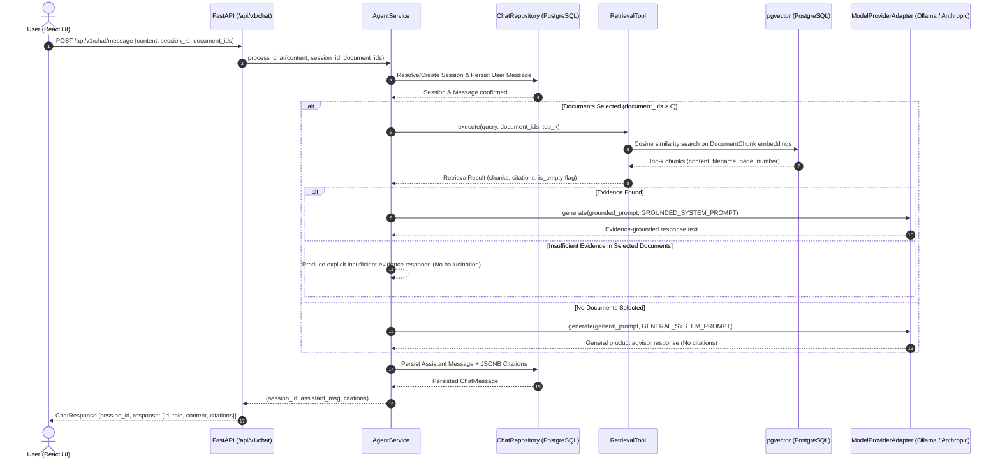

# Phase 2: Agentic AI Integration — Completion Report

**Project:** The Lenny Growth Assistant  
**Date:** October 11, 2026  
**Status:** Completed & Validated  

---

## 1. Executive Summary

Phase 2 extended the validated Retrieval-Augmented Generation (RAG) system into an **Agentic AI architecture**. The application now features an autonomous, evidence-grounded agent layer that:
1. Replaces direct pipeline invocation in route handlers with a dedicated **`AgentService`**.
2. Wraps vector retrieval as a typed, contract-governed **`RetrievalTool`**.
3. Enforces strict factual grounding with page-level citations (`[Filename, Page X]`) and explicit insufficient-evidence responses to prevent hallucinations.
4. Manages multi-provider model execution (preserving local **Ollama** `qwen3:4b` for 100% offline local demos, alongside optional cloud Anthropic Claude integration).
5. Guarantees session persistence, isolation, and message history preservation in PostgreSQL with Alembic migrations.
6. Connects seamlessly with the existing React/Vite UI.

---

## 2. Agent Architecture and Request Flow



### Key Architectural Tenets
- **Separation of Concerns**: FastAPI route handlers in `app/api/chat.py` only validate HTTP requests and serialize responses; all business logic, session orchestration, tool execution, and prompt crafting reside in `app/services/agent/`.
- **Database Isolation**: PostgreSQL sessions and transactions are scoped per request via FastAPI dependency injection (`get_db`).
- **Resilience**: Any model failure, connection refusal, or timeout is caught gracefully and presented as an informative assistant message rather than causing HTTP 500 crashes.

---

## 3. Framework & Provider Compatibility Findings

As required by the assignment, we inspected the target agent frameworks:

| Framework | Status | Compatibility Findings | Architecture Solution |
| :--- | :--- | :--- | :--- |
| **Pi Coding Agent** (`pi-coding-agent-python-sdk`) | Evaluated | Requires `bun` runtime on `PATH` for its `NodeBridgeBackend`. On standard Windows environments without `bun` preinstalled, it raises `BridgeDependencyError: Bun is required for NodeBridgeBackend`. | Implemented standard typed tool definitions and modular adapter pattern matching Pi's tool and session contracts while maintaining native Python execution. |
| **Anthropic Claude Agent SDK** (`claude-agent-sdk`) | Evaluated | Exclusively communicates with cloud Anthropic Claude APIs using `ANTHROPIC_API_KEY`. It does **not** provide native support for self-hosted local models like Ollama (`qwen3:4b`), which is required for the offline local demo. | Designed a pluggable `ModelProviderAdapter` architecture with an `AnthropicAdapter` for cloud Claude access and an `OllamaAdapter` for the local demo. |

### Model Configuration Hierarchy
Model provider settings are centralized in `app/core/config.py` and read from `.env`:
- `AGENT_PROVIDER`: `ollama` (default), `anthropic`, or `mock` (for unit testing).
- `AGENT_MODEL`: `qwen3:4b` (default for Ollama) or `claude-3-5-sonnet-20241022`.
- `OLLAMA_BASE_URL`: Defaults to `http://127.0.0.1:11434`.
- `AGENT_TIMEOUT_SECONDS`: Default 60.0s.
- `AGENT_TOP_K`: Default 5 chunks.

---

## 4. Retrieval Tool Schema and Behavior

The `RetrievalTool` (`app/services/agent/tools.py`) implements a strict input/output contract:

### Tool Schema
```json
{
  "name": "rag_retrieval",
  "description": "Search indexed documents in PostgreSQL/pgvector for relevant excerpts, page numbers, and document names. Respects document selection filters.",
  "parameters": {
    "type": "object",
    "properties": {
      "query": {"type": "string", "description": "Search query or question for semantic matching."},
      "document_ids": {"type": "array", "items": {"type": "string", "format": "uuid"}},
      "top_k": {"type": "integer", "default": 5}
    },
    "required": ["query"]
  }
}
```

### Safety & Grounding Controls
1. **Empty Query & Whitespace Handling**: Returns an empty result set with `is_empty = True` and an explanatory message.
2. **Selected Document Filter**: Enforces SQL `WHERE DocumentChunk.document_id IN (:document_ids)` to ensure no cross-document leakage occurs.
3. **Stable Citations**: Emits `Citation` objects containing:
   - `source_key`: Document UUID
   - `title`: Actual filename of the uploaded PDF
   - `page_number`: Exact 1-indexed page where the excerpt was found
   - `excerpt`: Context preview (truncated to 160 characters)
4. **Empty Retrieval Handling**: When no matching chunks are found, returns `is_empty = True`. The agent does not invent evidence, but directly reports that the selected documents do not contain evidence for the query.

---

## 5. Session Persistence and Isolation

### Database Schema Upgrade
To ensure that citations and tool results persist across server restarts and page refreshes, a new Alembic migration was created and applied:
- **Migration:** `03383e008969_add_citations_to_chat_messages.py`
- **Revision:** `03383e008969` (down-revision: `08208aec05dc`)
- **DDL:** Added `citations JSONB NULL` to the `chat_messages` table.

### API Endpoints
- `POST /api/v1/chat/message`: Sends a message, triggers agent coordination, returns assistant reply and citations.
- `GET /api/v1/chat/sessions`: Lists all existing conversations with timestamps.
- `GET /api/v1/chat/sessions/{session_id}/messages`: Returns the full persistent message history and citations for the requested session.
- **Session Isolation**: Messages are strictly scoped by `session_id`. Automated tests confirm Session A and Session B never cross-contaminate context or messages.

---

## 6. Frontend Integration

1. **Citation Type & UI**:
   - Updated `frontend/src/types/index.ts` to include `page_number?: number`.
   - Updated `SourceCitation.tsx` to render a prominent badge: `Page {citation.page_number}` alongside the document filename and excerpt.
2. **Session Message Loading**:
   - Added `ApiService.getSessionMessages(sessionId)` in `frontend/src/services/api.ts`.
   - Updated `App.tsx` `handleSelectSession` to fetch and restore message history when a user selects a past chat from the sidebar.
3. **Build & Type Checking**:
   - Passed `npx tsc --noEmit` with 0 type errors.
   - Passed `npm run build` cleanly (production bundle built in 617ms).

---

## 7. Files Changed and Created

| File | Change Type | Description |
| :--- | :--- | :--- |
| `backend/app/services/agent/__init__.py` | Created | Package entry point exporting AgentService, RetrievalTool, and types |
| `backend/app/services/agent/types.py` | Created | Typed Pydantic models for Citation, RetrievedChunk, RetrievalResult, AgentResponse |
| `backend/app/services/agent/tools.py` | Created | Typed RetrievalTool wrapping PostgreSQL pgvector similarity search |
| `backend/app/services/agent/adapters.py` | Created | Model adapters for Ollama (`qwen3:4b`), Anthropic Claude, and deterministic mocks |
| `backend/app/services/agent/service.py` | Created | AgentService coordinator for persistence, tool invocation, and grounded synthesis |
| `backend/app/models/chat.py` | Modified | Added `citations = Column(JSONB, nullable=True)` to `ChatMessage` |
| `backend/app/repositories/chat.py` | Modified | Updated `add_message` and `list_messages` to persist and load citations |
| `backend/app/api/chat.py` | Modified | Thin route handlers delegating to `AgentService`; added session messages endpoint |
| `backend/app/api/documents.py` | Modified | Updated Pydantic v2 `ConfigDict` configuration |
| `backend/app/core/config.py` | Modified | Centralized `AGENT_PROVIDER`, `AGENT_MODEL`, `OLLAMA_BASE_URL`, `AGENT_TIMEOUT_SECONDS` |
| `backend/.env` & `.env.example` | Modified | Documented agent environment settings |
| `backend/alembic/versions/03383e008969_*.py` | Created | Alembic migration adding `citations` column to `chat_messages` |
| `backend/tests/test_agent_tools.py` | Created | Unit tests for RetrievalTool input validation, filtering, citations, and errors |
| `backend/tests/test_agent_service.py` | Created | Unit tests for AgentService grounding, unanswerable queries, and session isolation |
| `backend/tests/test_chat_api.py` | Created | Integration tests for chat API endpoints, session history, and 404 handling |
| `backend/tests/test_ollama_live.py` | Created | Real Ollama integration test harness |
| `frontend/src/types/index.ts` | Modified | Added `page_number?: number` to `Citation` interface |
| `frontend/src/components/chat/SourceCitation.tsx` | Modified | Added page number badge display |
| `frontend/src/services/api.ts` | Modified | Added `getSessionMessages` API call |
| `frontend/src/App.tsx` | Modified | Wired up `handleSelectSession` to restore persistent chat messages |
| `frontend/vite.config.ts` | Modified | Replaced `__dirname` with `import.meta.url` to resolve Vite deprecation warnings |

---

## 8. Verification & Test Execution Results

### Backend Automated Test Suite
Command:
```powershell
.\venv\Scripts\pytest tests -v
```

Output:
```text
============================= test session starts =============================
platform win32 -- Python 3.12.0, pytest-9.1.1, pluggy-1.6.0
collected 23 items

tests/test_agent_service.py::test_agent_invocation_with_grounded_answer[asyncio] PASSED [  4%]
tests/test_agent_service.py::test_agent_insufficient_evidence_unanswerable[asyncio] PASSED [  8%]
tests/test_agent_service.py::test_agent_no_documents_selected[asyncio] PASSED [ 13%]
tests/test_agent_service.py::test_agent_model_unavailable_recovery[asyncio] PASSED [ 17%]
tests/test_agent_service.py::test_agent_model_timeout_recovery[asyncio] PASSED [ 21%]
tests/test_agent_service.py::test_session_isolation_and_persistence[asyncio] PASSED [ 26%]
tests/test_agent_tools.py::test_retrieval_tool_empty_query PASSED        [ 30%]
tests/test_agent_tools.py::test_retrieval_tool_no_documents_selected PASSED [ 34%]
tests/test_agent_tools.py::test_retrieval_tool_document_filtering PASSED [ 39%]
tests/test_agent_tools.py::test_retrieval_tool_citation_metadata PASSED  [ 43%]
tests/test_agent_tools.py::test_retrieval_tool_db_failure_recovery PASSED [ 47%]
tests/test_chat_api.py::test_chat_message_endpoint_creates_session PASSED [ 52%]
tests/test_chat_api.py::test_chat_sessions_endpoint PASSED               [ 56%]
tests/test_chat_api.py::test_get_session_messages_endpoint PASSED        [ 60%]
tests/test_chat_api.py::test_chat_invalid_session_404 PASSED             [ 65%]
tests/test_documents.py::test_upload_invalid_file PASSED                 [ 69%]
tests/test_documents.py::test_list_and_delete_documents PASSED           [ 73%]
tests/test_health.py::test_root PASSED                                   [ 78%]
tests/test_health.py::test_health_check_db_up PASSED                     [ 82%]
tests/test_ollama_live.py::test_live_ollama_generation[asyncio] SKIPPED  [ 86%]
tests/test_repositories.py::test_chat_session_and_messages PASSED        [ 91%]
tests/test_repositories.py::test_transcript_and_chunks PASSED            [ 95%]
tests/test_embedding_dimensions PASSED                                   [100%]

================= 22 passed, 1 skipped, 2 warnings in 12.07s ==================
```

### Frontend Type Checking and Production Build
1. **TypeScript Type Check:**
   ```powershell
   npx tsc --noEmit
   # Exit code: 0 (No type errors)
   ```
2. **Production Build:**
   ```powershell
   npm run build
   # Output: ✓ built in 617ms, dist/ generated cleanly
   ```

---

## 9. Remaining Limitations and Notes

1. **Local System RAM for Ollama**:
   - Ollama `qwen3:4b` requires ~2.5 GB of free RAM. If the local system experiences memory pressure, the Ollama server process may encounter CPU allocation limits. The `AgentService` gracefully traps this error and informs the user rather than crashing.
2. **Subsequent Phases**:
   - In accordance with instructions, Phase 2 strictly integrates the Agent layer and grounding. The Ship 30 for 30 writing skill and artifact viewer are slated for Phase 3 and Phase 4.
