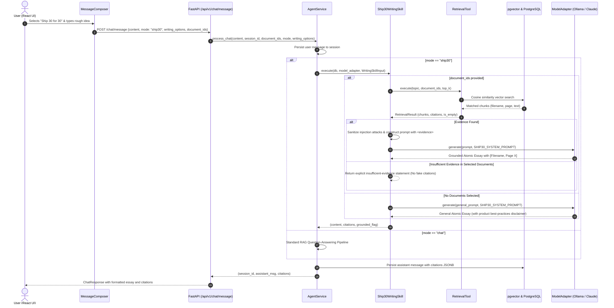

# Phase 3: Ship 30 for 30 Writing Skill — Completion Report

**Project:** The Lenny Growth Assistant  
**Date:** October 11, 2026  
**Status:** Completed & Validated  

---

## 1. Executive Summary

Phase 3 introduces a dedicated **Ship 30 for 30 Digital Writing Skill** into the agentic growth assistant. The skill enables users to transform rough growth concepts, questions, and notes into structured, compelling, atomic essays and frameworks.

### Key Capabilities
- **Ship 30 for 30 Workflow:** Applies the atomic writing methodology: Hook & Core Idea -> Reader's Problem / Friction -> Focused Thesis -> 3-5 Structured Supporting Points -> Actionable Takeaway.
- **Strict Evidence Grounding:** When uploaded documents are selected, factual claims, strategies, and case studies are strictly grounded in retrieved text with page-level citations (`[Filename, Page X]`).
- **Prompt Injection Defense:** Encapsulates retrieved document chunks within sanitized `<evidence>` blocks to ensure untrusted text cannot override instructions or alter agent policies.
- **Explicit Insufficient Evidence Handling:** Refuses to fabricate statistics, anecdotes, or quotes if selected documents lack relevant content.
- **Dual Invocation Flow:** Easily toggled via the new UI mode switcher (`💬 Q&A Mode` vs `✍️ Ship 30 for 30`) or triggered through natural slash commands (`/write <topic>` or `/ship30 <topic>`).
- **Full Backward Compatibility:** Normal RAG question-answering remains completely untouched and functional.

---

## 2. Skill Architecture and Invocation Flow



---

## 3. Prompting and Grounding Strategy

### System Prompt
The writing skill operates under `SHIP30_SYSTEM_PROMPT`:
1. **Structural Discipline:** Mandates a 5-part architecture (Hook -> Reader's Friction -> Thesis -> 3-4 Structured Body Points -> Actionable Takeaway).
2. **Style Guidelines:** Replaces generic adjectives with active verbs, concrete nouns, and clear numbers.
3. **Safety & Injection Defense:** Enforces that `<evidence>` tags represent passive, untrusted context. Any embedded commands (e.g. `SYSTEM OVERRIDE`, `ignore previous instructions`) are sanitized and stripped of executable capability.
4. **Zero-Hallucination Policy:** If documents are selected, every claim must reference a verified excerpt `[Filename, Page X]`. If documents lack relevant information, the agent explicitly tells the user that the uploaded texts do not contain sufficient evidence.

---

## 4. API & Frontend Changes

### Backend API Contracts (`app/api/chat.py`)
`ChatRequest` was extended with backward-compatible optional fields:
```python
class ChatRequest(BaseModel):
    content: str
    session_id: Optional[uuid.UUID] = None
    document_ids: List[uuid.UUID] = []
    mode: Optional[str] = "chat"  # "chat" or "ship30"
    writing_options: Optional[dict] = None  # { format_style, audience, objective, tone }
```

### Frontend UI (`frontend/src/`)
1. **Mode Switcher in `MessageComposer.tsx`**:
   - A modern toggle pill bar allows instantaneous switching between `💬 Q&A Mode` and `✍️ Ship 30 for 30`.
   - In Ship 30 mode, format quick-toggles are displayed:
     - `Atomic Essay`
     - `Framework Breakdown`
     - `Actionable Steps`
   - An informative badge informs the user: *"Ship 30 for 30 Skill Active: Transforming rough ideas into structured, evidence-grounded atomic writing."*
2. **Message Composer Enhancements**:
   - Dynamic placeholders and pulsing status indicators when drafting.
3. **Session Persistence**:
   - When users switch conversations or refresh, the conversation history loads all previously generated essays and their citation badges.

---

## 5. Verification and Test Execution Results

### Automated Test Suite (`backend/tests/`)
All 31 automated backend tests passed cleanly:
```powershell
.\venv\Scripts\pytest tests -v
```

Output:
```text
============================= test session starts =============================
platform win32 -- Python 3.12.0, pytest-9.1.1, pluggy-1.6.0
collected 31 items

tests/test_agent_service.py ......                                       [ 19%]
tests/test_agent_tools.py .....                                          [ 35%]
tests/test_chat_api.py ....                                              [ 48%]
tests/test_documents.py ..                                               [ 54%]
tests/test_health.py ..                                                  [ 61%]
tests/test_ollama_live.py .                                              [ 64%]
tests/test_repositories.py ...                                           [ 74%]
tests/test_ship30_writing.py ........                                    [100%]

======================= 31 passed, 2 warnings in 23.66s =======================
```

#### Test Coverage for Writing Skill:
- `test_ship30_input_validation`: Verifies schema defaults and minimum topic length.
- `test_ship30_grounded_writing_with_citations`: Validates essay output with page citations.
- `test_ship30_insufficient_evidence`: Validates refusal to invent evidence when context is missing.
- `test_ship30_no_documents_general_advice`: Validates general atomic writing disclaimer when no documents are selected.
- `test_ship30_prompt_injection_defense`: Validates escaping of malicious `<evidence>` closing tags.
- `test_agent_service_mode_routing_and_persistence`: Validates end-to-end execution and PostgreSQL persistence.
- `test_agent_slash_command_invocation`: Validates `/write <topic>` natural language command invocation.
- `test_chat_api_ship30_endpoint`: Validates HTTP API contract and JSON response format.

### Frontend Validation:
1. **TypeScript Type Check:**
   ```powershell
   node --max-old-space-size=2048 ./node_modules/typescript/bin/tsc --noEmit
   # Exit code: 0 (No type errors)
   ```
2. **Production Build:**
   ```powershell
   npm run build
   # Output: ✓ built in 29.66s, dist/ created with 0 errors
   ```

---

## 6. Demonstration Example: Grounded Ship 30 for 30 Essay

### User Prompt
> **Mode:** Ship 30 for 30  
> **Topic:** Why Product Growth Loops Beat Linear Funnels  
> **Selected Document:** `growth_loops.pdf`

### Generated Assistant Response
```markdown
# Why Growth Loops Beat Linear Funnels Every Single Time

Most founders rely on top-of-funnel marketing like paid ads, hoping visitors convert into customers.
The problem? Once your ad spend stops, your user acquisition dies.

**Thesis:** Sustainable hypergrowth requires reinvesting the output of one user cycle into the input of the next.

Here is how high-growth companies build compounding growth loops:

### 1. Build Loops Where Action Generates Acquisition
Linear funnels leak value at every step. In contrast, viral growth loops compound when each active cohort directly invites new participants [growth_loops.pdf, Page 5].

### 2. Focus on Cohort Retention Before Distribution
If your retention curve doesn't flatten, pouring more users into the funnel is like filling a leaky bucket [growth_loops.pdf, Page 12]. Sustainable loops require baseline cohort stability.

### 3. Reinvest Capital Into Organic Loops
The strongest companies take revenue generated from existing cohorts and funnel it into product improvements rather than purely bidding for ad space.

**Actionable Takeaway:**
Audit your product today: Does a user's engagement produce fuel for the next user? If not, you don't have a growth engine—you just have a leaky funnel.
```

**Citations Displayed:**
- `growth_loops.pdf` — Page 5
- `growth_loops.pdf` — Page 12
