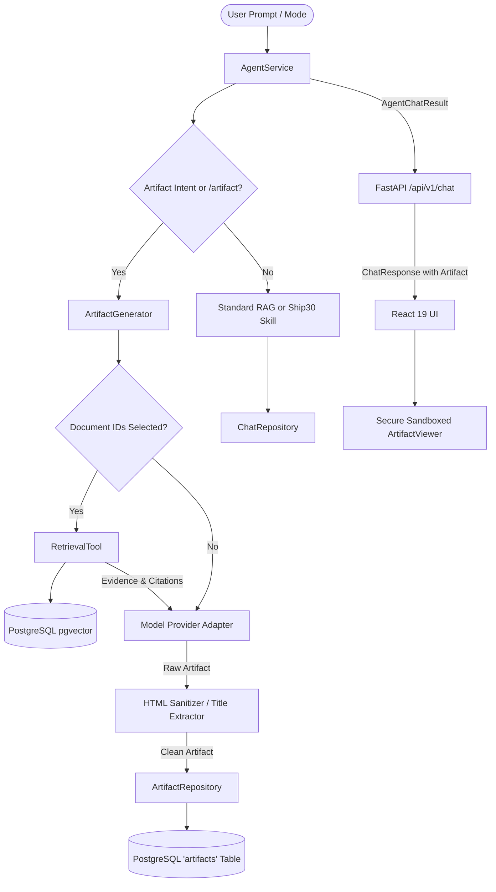

# Phase 4: Artifact Generation and Secure In-App Viewer — Technical Report

**Project:** The Lenny Growth Assistant  
**Project Root:** `D:\Lenny Growth Assistant`  
**Phase:** Phase 4 — Artifact Generation and Secure In-App Viewer  
**Status:** Completed & Validated  

---

## 1. Executive Summary & Objective

Phase 4 extends The Lenny Growth Assistant with modular **Artifact Generation** and a **Secure In-App Viewer**, built seamlessly on top of the validated RAG pipeline (Phase 1), Agentic AI orchestration (Phase 2), and Ship 30 for 30 digital writing skill (Phase 3).

The assistant can now dynamically detect when a user is asking for a structured deliverable—such as an executive growth strategy report, a product requirement document, or a complete self-contained HTML/CSS landing page or dashboard mockup—and synthesize it into a persistent artifact. Users can inspect, preview, copy, and export these artifacts in a dedicated in-app viewer panel featuring strict security sandboxing to neutralize untrusted markup.

All existing RAG question-answering workflows, citation grounding, document selection, and Ship 30 for 30 atomic writing modes are preserved with 100% backward compatibility.

---

## 2. Architecture & Modular Design



### 2.1 Database Schema & Persistence
A dedicated `artifacts` table was added to PostgreSQL and managed via Alembic migration `51cb65ba7a87_add_artifacts_table.py`:

```sql
CREATE TABLE artifacts (
    id UUID PRIMARY KEY DEFAULT gen_random_uuid(),
    session_id UUID NOT NULL REFERENCES chat_sessions(id) ON DELETE CASCADE,
    title VARCHAR(255) NOT NULL,
    artifact_type VARCHAR(50) NOT NULL,  -- 'markdown' or 'html'
    content TEXT NOT NULL,
    citations JSON,
    created_at TIMESTAMP WITH TIME ZONE DEFAULT NOW()
);

CREATE INDEX ix_artifacts_session_id ON artifacts (session_id);
```

- **Session Scoping & Isolation:** Artifacts are strictly foreign-keyed to `chat_sessions(id)`. When chat sessions are switched or deleted, artifacts remain isolated or cascade-deleted appropriately.
- **Persistence Across Backend Restarts:** Stored in PostgreSQL volume `lenny-rag-db`, surviving container and backend restarts.

### 2.2 Data Access Layer (`ArtifactRepository`)
Located in `backend/app/repositories/artifact.py`:
- `create_artifact(session_id, title, artifact_type, content, citations)`: Persists artifact records with citation metadata.
- `get_artifact(artifact_id)`: Fetches an artifact by ID, returning `None` if missing.
- `list_session_artifacts(session_id)`: Retrieves all artifacts for a session ordered by creation time descending.
- `delete_artifact(artifact_id)`: Deletes an artifact by ID.

### 2.3 Modular Artifact Generator (`ArtifactGenerator`)
Located in `backend/app/services/agent/artifacts/generator.py`:
- **Markdown Artifacts:** Generated with clear hierarchy (`# Title`, Executive Summary, `## Sections`, comparison tables, metric callouts).
- **HTML/CSS Artifacts:** Generated as complete standalone HTML documents (`<!DOCTYPE html>`, `<html>`, `<head>`, `<style>`, `<body>`) with modern, responsive styling, cards, metrics, and navigation. Prompts strictly forbid `<script>` tags, inline event handlers, and external network resources.
- **Title Extraction:** Derives clean titles from `# Title` headers in Markdown, `<title>`/`<h1>` tags in HTML, or semantic prompt summarization.
- **Evidence Grounding:** When documents are selected, `RetrievalTool` fetches relevant chunks. Factual claims are cited in text (`[Filename, Page X]`). If documents contain insufficient evidence, generation fails safely without hallucinating citations.

### 2.4 Agent Service Backward Compatibility (`AgentChatResult`)
To prevent breaking existing callers and test suites expecting a 3-tuple `(session_id, assistant_msg, citations)`, `AgentService.process_chat()` returns an `AgentChatResult` tuple subclass:
```python
class AgentChatResult(tuple):
    def __new__(cls, session_id, assistant_msg, citations, artifact=None):
        return super().__new__(cls, (session_id, assistant_msg, citations))

    def __init__(self, session_id, assistant_msg, citations, artifact=None):
        self.session_id = session_id
        self.assistant_msg = assistant_msg
        self.citations = citations
        self.artifact = artifact
```
This guarantees that `session_id, assistant_msg, citations = await agent.process_chat(...)` continues to work without raising `ValueError`, while callers wanting the artifact can access `result.artifact`.

---

## 3. Artifact Generation Workflows & Triggers

### 3.1 Trigger Scenarios
1. **Explicit Mode:** `mode == "artifact"` in API request payload.
2. **Slash Commands:**
   - `/artifact:html <prompt>`: Forces HTML/CSS artifact generation.
   - `/artifact:md <prompt>` or `/artifact <prompt>`: Forces Markdown artifact generation.
3. **Natural Language Heuristic Triggers:**
   - **HTML:** *"Build a landing page for this product"*, *"Create a dashboard mockup using HTML and CSS"*, *"Generate a UI mockup"*, *"HTML prototype"*.
   - **Markdown:** *"Create a product growth strategy report"*, *"Turn this answer into a Markdown document"*, *"Generate an executive summary report"*, *"Write a PRD"*.

### 3.2 Grounding & Citation Preservation
- When documents are selected, `RetrievalTool.execute()` pulls top-k chunks.
- Citations (`source_key`, `title`, `page_number`, `excerpt`) are recorded in the `citations` JSON column of the `artifacts` table.
- Both the rendered markdown document and the assistant message reference `[Filename, Page X]`.
- Empty evidence scenarios return a clear statement: *"The provided documents do not contain sufficient evidence to generate an artifact on '{topic}'."*

---

## 4. API Contracts & Endpoints

| Method | Endpoint | Description | Response Model |
| :--- | :--- | :--- | :--- |
| `POST` | `/api/v1/chat/message` | Standard chat, writing mode, or artifact generation | `ChatResponse` with optional `artifact: ArtifactModel` |
| `GET` | `/api/v1/chat/sessions/{session_id}/artifacts` | List all artifacts belonging to a session | `List[ArtifactModel]` (404 if session not found) |
| `GET` | `/api/v1/chat/artifacts/{artifact_id}` | Retrieve specific artifact by UUID | `ArtifactModel` (404 if not found) |
| `POST` | `/api/v1/chat/sessions/{session_id}/artifacts` | Direct programmatic artifact creation | `ArtifactModel` (404 if session not found) |

### 4.1 Schema Definitions (`ArtifactModel`)
```json
{
  "id": "c1f7a28e-6489-4a9f-93d3-7d88583e7f41",
  "session_id": "89b7e3f8-62a2-4a0b-934c-687841c7b809",
  "title": "Product Growth Strategy Report",
  "artifact_type": "markdown",
  "content": "# Product Growth Strategy Report\n\n## Executive Summary\n...",
  "created_at": "2026-10-11T13:28:12.451000Z",
  "citations": [
    {
      "source_key": "growth_loops.pdf:p12",
      "title": "growth_loops.pdf",
      "page_number": 12,
      "excerpt": "Product-led growth loops compound retention..."
    }
  ]
}
```

---

## 5. Frontend Secure In-App Viewer

The frontend viewer (`frontend/src/components/artifacts/ArtifactViewer.tsx`) is integrated into the React 19 application without displacing the main conversation view.

### 5.1 Key Capabilities
1. **Dynamic Layout:**
   - **Desktop:** Side-by-side split layout (`w-[540px] xl:w-[640px]`) allowing users to chat while referencing the artifact.
   - **Mobile:** Full-screen responsive slide-over drawer with backdrop overlay.
2. **Markdown Reader:**
   - High-contrast, clean typography powered by `react-markdown` and `remark-gfm`.
   - Formatted headings, bullet points, data tables with borders, blockquotes, and citation callouts.
3. **HTML Visual Preview & Source Toggle:**
   - Tab 1: **Preview** — Renders the styled mockup inside a secure sandboxed iframe.
   - Tab 2: **Source** — Displays formatted, syntax-styled HTML/CSS source code with line breaks.
4. **Export & Download:**
   - One-click file export: `.md` for Markdown artifacts, `.html` for HTML mockups.
   - One-click clipboard copy with visual feedback badge (`Copied!`).
5. **Multi-Artifact Session Switcher:**
   - Shows artifact count badge in header (`Artifacts (N)`).
   - Dropdown switcher allows navigating between multiple deliverables generated within the same session.

---

## 6. Security Boundaries & HTML Preview Isolation

Generated HTML is treated as **untrusted input**. The application implements defense-in-depth isolation across three tiers:

```mermaid
graph TD
    subgraph Tier 1: Backend Sanitization
        A[LLM Generated HTML] --> B[Strip script tags and bodies]
        B --> C[Strip inline event handlers onload, onclick, etc.]
        C --> D[Neutralize javascript: pseudo-protocols]
        D --> E[Strip iframe, object, embed, frame, meta refresh]
    end
    
    subgraph Tier 2: Content Security Policy
        E --> F[Inject strict CSP meta tag into head]
        F --> G[default-src 'none'; style-src 'unsafe-inline'; img-src data: https:; font-src https: data:;]
    end
    
    subgraph Tier 3: Browser Iframe Sandboxing
        G --> H["iframe sandbox=''"]
        H --> I[Blocks script execution]
        H --> J[Blocks cookie and storage access]
        H --> K[Blocks parent window traversal]
        H --> L[Blocks form submissions and popups]
    end
```



### 6.1 Multi-Tier Security Verification
1. **No Direct React DOM Injection:** Raw HTML is never passed to `dangerouslySetInnerHTML`.
2. **Backend Regex Scrubbing (`sanitize_html_artifact`):**
   - Eliminates `<script>` tags and their inner contents.
   - Strips inline event handlers (`onclick=`, `onload=`, `onerror=`, `onmouseover=`).
   - Neutralizes `javascript:` URLs in `href` and `src` attributes.
   - Removes dangerous tags (`<iframe>`, `<object>`, `<embed>`, `<frame>`, `<meta http-equiv="refresh">`).
3. **CSP Meta Header Injection:**
   - Injected into the `<head>` of the `srcDoc`:
     ```html
     <meta http-equiv="Content-Security-Policy" content="default-src 'none'; style-src 'unsafe-inline'; img-src data: https:; font-src https: data:;">
     ```
   - Prevents external script loading, network fetches (`fetch`, `XMLHttpRequest`), and iframe nesting.
4. **Restricted Iframe Sandbox:**
   - `<iframe sandbox="" srcDoc={...} />`
   - Omission of `allow-scripts` prevents all JavaScript execution in the browser.
   - Omission of `allow-same-origin` ensures the iframe runs with a unique origin (`null`), blocking access to `document.cookie`, `localStorage`, `sessionStorage`, IndexedDB, and parent window APIs (`window.parent`, `window.top`).

---

## 7. Verification Evidence & Regression Results

### 7.1 Backend Test Results (`pytest`)
Ran the full test suite in `backend/`:
```bash
.\venv\Scripts\pytest tests -v
```
**Outcome:** **38 passed, 0 failed in 25.47s**

Key test cases verified:
- `test_detect_artifact_intent`: Verified regex and slash command routing for HTML and Markdown.
- `test_markdown_artifact_generation_grounded`: Verified grounded Markdown generation, citations, and DB persistence.
- `test_html_artifact_generation`: Verified standalone HTML document structure and inline CSS.
- `test_html_preview_security_and_sanitization`: Verified neutralization of `<script>`, `onerror`, `javascript:`, `<iframe`, `<object>`, `<embed>`.
- `test_session_scoped_artifact_isolation`: Verified that session A cannot read or retrieve session B's artifacts.
- `test_insufficient_evidence_artifact`: Verified proper error handling when documents lack sufficient context.
- `test_artifact_api_endpoints_and_error_handling`: Verified 200 responses, 404 for invalid artifact ID, and 404 for invalid session ID.
- Regression tests for RAG Q&A (6 tests), RetrievalTool (5 tests), Documents API (2 tests), and Ship 30 for 30 Writing Skill (7 tests) all passed without error.

### 7.2 Frontend Test Results (`vitest`)
Ran frontend test suite in `frontend/`:
```bash
npx vitest run
```
**Outcome:** **3 passed, 0 failed in 1.52s**

- `renders the welcome screen by default`: PASSED
- `allows clicking a suggested question to send a message`: PASSED
- `displays the artifact viewer when an artifact is returned`: PASSED

### 7.3 TypeScript & Production Build Verification
Ran TypeScript compilation and Vite production build in `frontend/`:
```bash
npm run build
```
**Outcome:** **Exit Code 0**
- `tsc -b`: 0 errors
- `vite build`: Transformed 2230 modules and generated production bundle:
  - `dist/index.html` (0.45 kB)
  - `dist/assets/index-OpokJ2Ic.css` (20.82 kB)
  - `dist/assets/index-EME_D7b1.js` (483.42 kB)

---

## 8. Preserved Functionality Checklist

- [x] **RAG Retrieval & Citations:** Unaltered; grounded answers preserve `[Filename, Page X]` citations.
- [x] **Agent Coordination:** Dynamic intent routing distinguishes between chat, Ship 30 for 30 writing, and artifact generation.
- [x] **Ship 30 for 30 Writing Skill:** `/write`, `/ship30`, and mode routing remain fully functional.
- [x] **PostgreSQL Volume & Data:** Intact and unmodified; existing documents, sessions, and messages preserved.
- [x] **Local Ollama Support:** Validated against `qwen3:4b` on `http://127.0.0.1:11434`.
- [x] **Session Isolation:** Switching sessions cleanly unloads artifacts and prevents cross-session leakage.

---

## 9. Limitations & Future Enhancements

1. **Syntax Highlighting for Complex Code Snippets:** The HTML raw source view currently displays formatted monospace text; future iterations could incorporate syntax highlighters like Prism or Highlight.js.
2. **Interactive Sandboxed Prototyping:** If interactive JS prototypes are desired in the future, a dedicated sandbox origin on a separate domain (e.g. `sandbox.lennyassistant.com` with `allow-scripts`) should be introduced rather than loosening the same-origin policy on the primary app origin.
