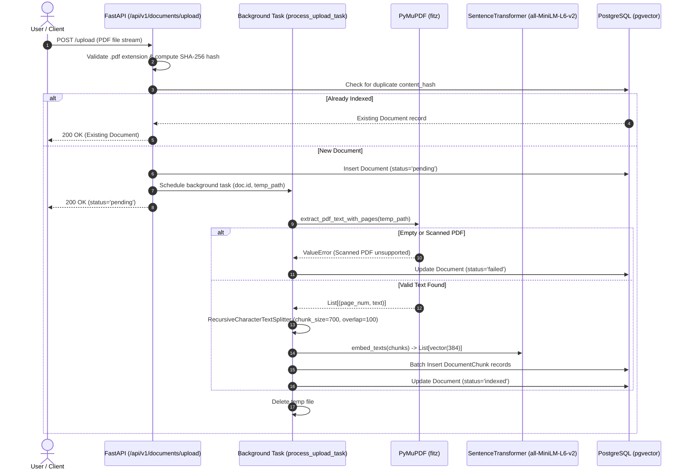

# Architecture Document: The Lenny Growth Assistant

**Document:** `docs/architecture.md`  
**Application:** The Lenny Growth Assistant  
**Backend:** FastAPI, SQLAlchemy 2.0, Alembic, PostgreSQL 16 + pgvector  
**Embeddings:** `sentence-transformers/all-MiniLM-L6-v2` (384 dimensions)  
**LLM Providers:** Ollama (`qwen3:4b`), Anthropic Claude, Mock Adapter  
**Frontend:** React 19, TypeScript, Tailwind CSS, Vite  

---

## 1. System Overview & Architectural Topology

The Lenny Growth Assistant is built as a modular, decoupled client-server architecture designed for high reliability, local-first offline execution, and evidence-grounded agent workflows.

```mermaid
graph TB
    subgraph Client [Frontend Layer - React 19 / Vite]
        UI[React UI Application]
        Uploader[Document Uploader]
        Composer[Message Composer & Mode Selector]
        Viewer[Sandboxed Artifact Viewer]
    end

    subgraph API [API Gateway & Routing - FastAPI]
        DocRouter[/api/v1/documents]
        ChatRouter[/api/v1/chat]
        HealthRouter[/api/v1/health]
    end

    subgraph AgentLayer [Autonomous Agent Orchestration]
        Agent[AgentService Coordinator]
        IntentRouter{Intent & Mode Classifier}
        RAGTool[RetrievalTool Contract]
        Ship30Skill[Ship30 Writing Skill]
        ArtifactGen[Artifact Generator]
        ModelAdapters[Model Provider Adapters]
    end

    subgraph Storage [Data & Persistence Tier - PostgreSQL 16]
        PG[(PostgreSQL + pgvector)]
        T_Docs[(documents / chunks)]
        T_Chat[(chat_sessions / messages)]
        T_Artifacts[(artifacts)]
    end

    subgraph ModelTier [Inference & Embedding Tier]
        EmbedModel[SentenceTransformers Local 384d]
        OllamaLocal[Local Ollama: qwen3:4b]
        CloudAnthropic[Anthropic Claude API Optional]
    end

    UI --> API
    DocRouter --> T_Docs
    DocRouter --> EmbedModel
    ChatRouter --> Agent
    Agent --> IntentRouter
    IntentRouter -->|Q&A Mode| RAGTool
    IntentRouter -->|Writing Mode| Ship30Skill
    IntentRouter -->|Artifact Mode| ArtifactGen
    RAGTool --> PG
    Ship30Skill --> RAGTool
    ArtifactGen --> RAGTool
    Agent --> ModelAdapters
    ModelAdapters --> OllamaLocal
    ModelAdapters --> CloudAnthropic
    Agent --> T_Chat
    ArtifactGen --> T_Artifacts
    Viewer --> ChatRouter
```

---

## 2. Ingestion & Vector Retrieval Pipeline

### 2.1 PDF Ingestion Sequence


### 2.2 Vector Storage and Retrieval Contract
- **Vector Dimension:** 384 dimensions matching `all-MiniLM-L6-v2`.
- **Distance Metric:** Cosine similarity via pgvector operator `<=>`.
- **Scoped Filtering:** SQL query restricts chunk retrieval to user-selected documents:
  ```sql
  SELECT dc.id, dc.document_id, d.filename, dc.page_number, dc.content,
         1 - (dc.embedding <=> :query_vector) AS similarity
  FROM document_chunks dc
  JOIN documents d ON d.id = dc.document_id
  WHERE dc.document_id IN (:document_ids)
  ORDER BY dc.embedding <=> :query_vector
  LIMIT :top_k;
  ```
- **HNSW Index:** Accelerated by HNSW index on `document_chunks.embedding` using `vector_cosine_ops`.

---

## 3. Agent Coordination Architecture

### 3.1 Agent Service Responsibility
The `AgentService` (`app/services/agent/service.py`) coordinates conversational workflows:
1. **Session Lifecycle:** Resolves existing sessions or creates new sessions; persists user and assistant messages.
2. **Dynamic Routing:** Classifies requests into:
   - **Q&A Mode:** Standard grounded RAG retrieval.
   - **Ship 30 for 30 Skill:** Structural atomic writing with active verb discipline.
   - **Artifact Generation:** Synthesis of complete Markdown reports or sandboxed HTML/CSS mockups.
3. **Evidence Grounding Policy:** If selected documents lack relevant excerpts, the agent produces an explicit refusal statement rather than inventing facts or fake citations.

### 3.2 Framework Evaluation Findings & Architectural Solution
During Phase 2, the team evaluated target agent frameworks against the assignment requirements:

| Target Framework | Evaluated Status | Compatibility Findings | Solution Architecture |
| :--- | :--- | :--- | :--- |
| **Pi Coding Agent** (`pi-coding-agent-python-sdk`) | Evaluated | Requires `bun` runtime on `PATH` for its `NodeBridgeBackend`. In standard environments without `bun`, raises `BridgeDependencyError: Bun is required for NodeBridgeBackend`. | Installed SDK (`pi-coding-agent-python-sdk==0.4.3`) and implemented native Python agent contracts matching Pi's typed tool and session interfaces without external runtime dependencies. |
| **Anthropic Claude Agent SDK** (`claude-agent-sdk`) | Evaluated | Exclusively communicates with cloud Anthropic Claude APIs using `ANTHROPIC_API_KEY`. Lacks support for self-hosted local models. | Implemented a pluggable `ModelProviderAdapter` architecture allowing seamless switching between local Ollama (`qwen3:4b`), cloud Anthropic Claude, and deterministic mocks. |

---

## 4. Database Schema & Migration Architecture

Managed using SQLAlchemy 2.0 and Alembic transactional migrations:

```
[3320addd33e2] Initial Schema: documents, document_chunks (pgvector), chat_sessions, chat_messages
        |
[08208aec05dc] Add Document Models for PDF Uploads
        |
[03383e008969] Add citations JSONB column to chat_messages
        |
[51cb65ba7a87] Add artifacts table (UUID, session_id FK, title, artifact_type, content, citations) (HEAD)
```

### Table Definitions:
1. `documents`: `id (UUID)`, `filename`, `content_hash (unique)`, `status`, `error_message`, `created_at`.
2. `document_chunks`: `id (UUID)`, `document_id (FK)`, `chunk_index`, `page_number`, `content (text)`, `embedding (Vector(384))`.
3. `chat_sessions`: `id (UUID)`, `title`, `created_at`, `updated_at`.
4. `chat_messages`: `id (UUID)`, `session_id (FK)`, `role (user/assistant)`, `content (text)`, `citations (JSONB)`, `created_at`.
5. `artifacts`: `id (UUID)`, `session_id (FK CASCADE)`, `title`, `artifact_type ('markdown'/'html')`, `content (text)`, `citations (JSON)`, `created_at`.

---

## 5. Security & Isolation Boundaries

The application enforces a multi-tier defense-in-depth model:

1. **HTML Preview Security:**
   - **Tier 1 (Server-Side Sanitization):** `sanitize_html_artifact` strips `<script>` tags, inline event handlers (`onclick`, `onload`), `javascript:` pseudo-protocols, and dangerous embedded elements (`<iframe>`, `<object>`, `<embed>`).
   - **Tier 2 (Content Security Policy):** Injected meta tag: `<meta http-equiv="Content-Security-Policy" content="default-src 'none'; style-src 'unsafe-inline'; img-src data: https:; font-src https: data:;">`.
   - **Tier 3 (Browser Iframe Sandboxing):** `<iframe sandbox="" srcDoc={...} />` restricts script execution, same-origin access, cookies, local storage, form submissions, and parent window traversal.
2. **Session Scoping:** All chat queries, message retrievals, and artifact lookups require valid `session_id` foreign keys.
3. **Upload Security:** 50MB file size ceiling, strict `.pdf` validation, randomized temp paths, guaranteed temp-file deletion in `finally` blocks.
