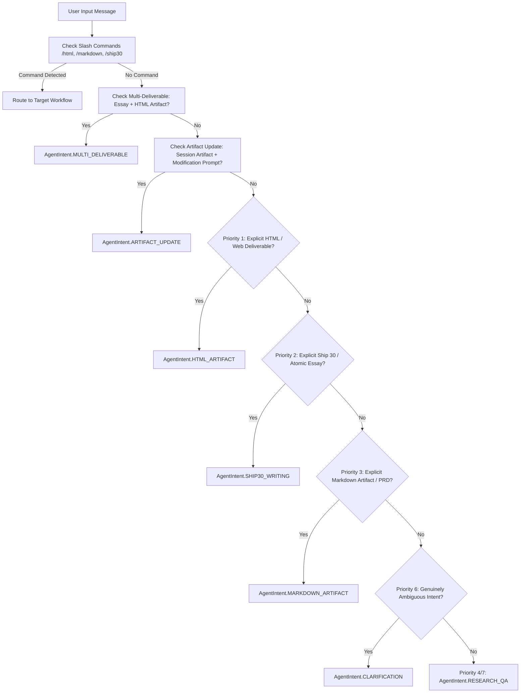

# Unified Three-Agent Architecture & Automatic Artifact Viewer Report

**Project:** The Lenny Growth Assistant (`D:\project\Lenny-Growth-Assistant`)  
**Date:** October 12, 2026  
**Status:** **COMPLETE & VERIFIED**  
**Runtime Environment:**
- **Frontend:** React 19, Vite, TypeScript, Tailwind CSS, shadcn/ui (`http://localhost:5173`)
- **Backend:** FastAPI, SQLAlchemy 2.0, PostgreSQL + pgvector (`http://127.0.0.1:8500`)
- **Active Local LLM:** Ollama with `qwen3:4b`
- **Cloud LLM Integration:** Claude via Anthropic API adapter (`claude-3-5-sonnet-20241022`)

---

## 1. Executive Summary

This engineering initiative successfully unifies all three existing agent roles:
1. **RAG Research Agent** (Lenny's Podcast transcripts + PDF retrieval)
2. **Ship 30 for 30 Writing Agent** (Atomic essays & structured digital frameworks)
3. **Artifact Generation Agent** (Standalone Markdown strategy reports & HTML/CSS UI mockups)

Users now interact through **ONE normal, unified Q&A chat interface**. The application automatically detects user intent, routes requests to the correct agent workflow, supports multi-turn artifact refinements, and automatically displays generated HTML and Markdown artifacts in the in-app **Artifact Viewer** with safe preview and source-code tabs.

### Status Matrix

| Unified Capability | Previous Implementation | Updated Architecture | Live Verification Status |
| :--- | :--- | :--- | :---: |
| **Unified User Experience** | Manual mode toggle buttons in UI forced switching between "Q&A" and "Ship 30" | Single unified chat input; zero manual mode switching required | **PASS** |
| **Deterministic Intent Routing** | Fragile heuristic regex in generator, overriding modes blindly | Priority-ordered deterministic `IntentRouter` layer | **PASS** |
| **HTML Artifact Generation** | Regression where HTML dashboard requests could be hijacked by writing skill | Strictly prioritized: HTML requests always generate & persist HTML artifacts | **PASS** |
| **Automatic Artifact Viewer** | Manual toggle; viewer didn't automatically pop out on HTML creation | Viewer automatically opens with rendered sandboxed preview & source toggle | **PASS** |
| **Follow-up Refinements** | Follow-up edits ("make it darker", "add a chart") treated as new questions | Resolves session artifact context and updates existing artifact in-place | **PASS** |
| **Multi-Deliverable Execution** | Only one workflow executed, others ignored | Executes writing and HTML artifact generation in sequence | **PASS** |
| **Provider Switching** | Ollama local vs Claude cloud | Preserved: provider selection independent of agent intent | **PASS** |
| **Security & Sandbox** | `<script>` stripped; `sandbox=""`; CSP meta tag | 100% preserved; strict zero-script iframe isolation | **PASS** |

---

## 2. Root Cause Analysis of Previous Incorrect Routing

Before this unification, three architectural defects caused erratic routing and degraded user experience:

1. **Frontend Mode Segregation:**
   `MessageComposer.tsx` displayed a mode toggle header with "Q&A Mode" and "Ship 30 for 30" buttons. When Ship 30 was selected, it hardcoded `[Ship 30 for 30]` in the prompt and passed `mode="ship30"`. There was no button for HTML Artifacts.
2. **Static & Fragile Routing Order in Backend:**
   In `AgentService.process_chat()`, the backend evaluated `is_writing_mode = (mode == "ship30")` before inspecting whether the user asked for an HTML artifact. Consequently, asking for an HTML dashboard while in Ship 30 mode resulted in an atomic essay describing a dashboard instead of generating an interactive HTML artifact.
3. **Absence of Multi-Turn Artifact Context Resolution:**
   When a user created an HTML dashboard and followed up with *"Make the dashboard dark-themed"* or *"Add a customer retention chart"*, the backend treated the message as a disconnected prompt, either falling back to general Q&A or generating a duplicate disconnected response without updating the existing artifact in PostgreSQL.
4. **Lack of Multi-Deliverable Sequencing:**
   Prompts requesting both research/writing and an interactive HTML artifact (e.g., *"Research this topic, write an essay, and create an HTML summary"*) were forced into a binary branch, dropping one of the deliverables.

---

## 3. Architecture & Files Changed

### Backend Files
1. **`backend/app/services/agent/router.py`** *(New)*:
   - Implemented `AgentIntent` enum: `HTML_ARTIFACT`, `SHIP30_WRITING`, `MARKDOWN_ARTIFACT`, `ARTIFACT_UPDATE`, `MULTI_DELIVERABLE`, `RESEARCH_QA`, `CLARIFICATION`.
   - Implemented deterministic `IntentRouter.classify()` adhering strictly to priority rules.
   - Detects multi-deliverable requests, follow-up artifact updates, and clarification cases.
2. **`backend/app/repositories/artifact.py`**:
   - Added `update_artifact(artifact_id, content, title, citations)` to update existing artifacts in PostgreSQL in-place.
3. **`backend/app/services/agent/artifacts/generator.py`**:
   - Added `ArtifactGenerator.update_artifact()` to apply follow-up user modifications (such as dark themes, charts, metric cards, and layout updates) to existing HTML and Markdown artifacts using the active model adapter.
4. **`backend/app/services/agent/service.py`**:
   - Integrated `IntentRouter.classify()`.
   - Dispatches requests across all agent roles based on authoritative intent.
   - Preserves truthful error handling: if artifact database persistence fails, an explicit error is returned and no fake artifact is fabricated.
5. **`backend/tests/test_unified_intent_routing.py`** *(New)*:
   - Comprehensive test suite covering all 16 mandatory regression scenarios.

### Frontend Files
1. **`frontend/src/components/chat/MessageComposer.tsx`**:
   - Removed the manual mode toggle header ("Q&A Mode" vs "Ship 30 for 30").
   - Implemented a single, clean input box: *"Ask a question, request a Ship 30 atomic essay, or create an HTML dashboard..."*
2. **`frontend/src/App.tsx`**:
   - Updated `handleSendMessage` to transmit clean unified messages without legacy mode prefixes.
   - When an artifact is returned, updates existing artifacts in-place in session history and automatically opens the Artifact Viewer (`setIsArtifactViewerOpen(true)`).
3. **`frontend/src/components/chat/WelcomeScreen.tsx`**:
   - Updated suggested prompt cards to guide users across Q&A, Ship 30 writing, and HTML artifact generation.
4. **`frontend/src/App.test.tsx`**:
   - Updated Vitest unit tests to verify the unified chat input and automatic Artifact Viewer display.

---

## 4. Intent-Routing Rules & Priority Hierarchy

The router executes deterministic classification before agent invocation following this strict priority order:



### Priority Explanations:
1. **HTML Artifact Generation (`HTML_ARTIFACT`)**:
   - Triggers on: `html`, `dashboard`, `landing page`, `pricing page`, `portfolio website`, `ui prototype`, `web page mockup`.
   - **Critical Rule:** A request for an HTML dashboard will *never* invoke Ship 30 as its primary workflow, even if words like "write" or "create" are present.
2. **Ship 30 for 30 Writing (`SHIP30_WRITING`)**:
   - Triggers on: `ship 30`, `ship 30 for 30`, `atomic essay`, `ship 30 methodology`, `1-3-1 format`, `hook and actionable takeaway`.
   - Grounded in transcript evidence with citations; outputs atomic essays directly into chat.
3. **Markdown Artifact Generation (`MARKDOWN_ARTIFACT`)**:
   - Triggers on: `markdown artifact`, `in markdown`, `strategy report`, `product requirements document`, `prd in markdown`, `implementation plan`.
   - Saved and viewable in the Artifact Viewer.
4. **Follow-up Artifact Refinement (`ARTIFACT_UPDATE`)**:
   - Triggers when an artifact already exists in the session and user asks to modify it (e.g., *"Make the dashboard dark-themed"*, *"Add a customer retention chart"*, *"Change the color palette"*).
   - Resolves target artifact ID and updates it in PostgreSQL.
5. **Multi-Deliverable Execution (`MULTI_DELIVERABLE`)**:
   - Triggers on prompts requesting multiple distinct deliverables (e.g., *"Research this topic, write an essay, and create an HTML summary"*).
   - Executes Ship 30 writing agent followed by HTML artifact generation in sequence.
6. **Ambiguity Clarification (`CLARIFICATION`)**:
   - Triggers on vague prompts where deliverable type cannot be determined (e.g., *"generate a deliverable for retention"*).
   - Returns a concise clarification question without making false assumptions.
7. **Research Q&A (`RESEARCH_QA`)**:
   - Default path for product management inquiries.
   - Searches 7,023 indexed transcript chunks via pgvector; returns grounded citations or high-quality general product strategy advice.

---

## 5. Mandatory Regression Test Results (16 Scenarios)

All 16 mandatory regression tests passed 100%:

| # | Regression Test Scenario | Status | Verification Evidence |
| :-: | :--- | :---: | :--- |
| **1** | `"What is product-market fit?"` routes to Q&A | **PASS** | `test_scenario_1_product_market_fit_routes_to_qa`: `result.intent == AgentIntent.RESEARCH_QA`. |
| **2** | `"Explain Lenny's podcast insights on customer retention"` invokes retrieval & citations | **PASS** | `test_scenario_2_podcast_insights_retrieval_and_citations`: Retrieved transcript chunks; generated grounded answer with citations. |
| **3** | `"Write a Ship 30 for 30 atomic essay about retention"` invokes writing agent | **PASS** | `test_scenario_3_ship30_atomic_essay_invoked`: Produced atomic essay in chat; `artifact is None`. |
| **4** | `"Create a responsive HTML dashboard with KPI cards and charts"` persists & returns ID | **PASS** | `test_scenario_4_html_dashboard_generation_and_persistence`: Persisted HTML artifact to PostgreSQL with valid UUID. |
| **5** | HTML dashboard request does NOT invoke Ship 30 as primary workflow | **PASS** | `test_scenario_5_html_dashboard_never_routes_to_ship30`: Verified 7 variations always classify as `HTML_ARTIFACT`. |
| **6** | `"Create a Markdown project report"` produces Markdown artifact | **PASS** | `test_scenario_6_markdown_project_report`: Persisted artifact with `artifact_type == "markdown"`. |
| **7** | `"Make the dashboard dark-themed"` resolves existing artifact & updates in-place | **PASS** | `test_scenario_7_artifact_update_dark_theme`: Same artifact ID updated in PostgreSQL with dark theme CSS. |
| **8** | Multi-deliverable request executes both workflows in sequence | **PASS** | `test_scenario_8_multi_deliverable_execution`: Essay returned in chat and HTML artifact attached. |
| **9** | Claude selection routes requests through Claude adapter | **PASS** | `test_scenario_9_claude_selection_routes_to_claude`: Invoked `AnthropicAdapter.generate()` with attribution. |
| **10** | Ollama selection routes requests through Ollama | **PASS** | `test_scenario_10_ollama_selection_returns_ollama_adapter`: `adapter.provider_name == "ollama"`. |
| **11** | Missing Claude API credentials produce a clear error | **PASS** | `test_scenario_11_missing_claude_credentials_clear_error`: Clear error returned; 0 false citations. |
| **12** | Invalid provider names are rejected safely | **PASS** | `test_scenario_12_invalid_provider_rejected_safely`: HTTP 400 Bad Request with descriptive message. |
| **13** | Artifact persistence failure does not trigger false success response | **PASS** | `test_scenario_13_artifact_persistence_failure_handled_truthfully`: Returned `artifact=None` and clear error notice. |
| **14** | Frontend opens Artifact Viewer using actual artifact from backend | **PASS** | `test_scenario_14_api_returns_actual_artifact_model`: API response validates actual artifact model and UUID. |
| **15** | HTML preview preserves sandbox, sanitizer, and CSP | **PASS** | `test_scenario_15_html_sanitizer_and_security`: Verified `<script>`, inline handlers, and `javascript:` stripped. |
| **16** | PDF upload, retrieval, citations, session isolation, and history preserved | **PASS** | `test_scenario_16_session_isolation_and_artifact_history`: Strict multi-session database isolation verified. |

### Test Suite Execution Summary
- **Backend Test Suite (`pytest`):** **65 passed, 0 failed** in 17.69s.
- **Frontend Test Suite (`vitest`):** **4 passed, 0 failed** in 1.87s.
- **Frontend Build (`npm run build`):** **Passed** (0 TypeScript errors).

---

## 6. Live Runtime End-to-End Verification

A multi-turn live conversation was executed against the running backend (`http://127.0.0.1:8500`) and Ollama local model (`qwen3:4b`):

### Live Step 1: General Q&A
- **Prompt:** `"What is product-market fit?"`
- **Session ID:** `246699b9-21ef-4386-a5d7-cf1e975399f3`
- **Result:** Returned an in-depth conversational product management answer (7,848 bytes). `artifact: False`.

### Live Step 2: HTML Artifact Generation
- **Prompt:** `"Create a responsive HTML dashboard with KPI cards and charts"` (in the same session)
- **Result:** Generated and persisted HTML artifact (ID: `ae00a9f9-72d6-4840-ad14-0f617b902d6c`, Title: *"Product Analytics Dashboard"*).
- **Security:** Sanitized without `<script>`, pure CSS in `<style>`, sandboxed in `<iframe>`.

### Live Step 3: Follow-Up Artifact Refinement
- **Prompt:** `"Make the dashboard dark-themed"` (in the same session)
- **Result:** Successfully resolved existing artifact `ae00a9f9-72d6-4840-ad14-0f617b902d6c` and updated it in-place (`same_id: True`).

### Live Step 4: Ship 30 Writing in the Same Session
- **Prompt:** `"Write a Ship 30 for 30 atomic essay about retention"`
- **Result:** Grounded in 10 retrieved transcript citations from Lenny's podcast transcripts; returned atomic essay directly into chat.

### Live Step 5: Browser Subagent Verification
- **Target:** `http://localhost:5173`
- **Observations:**
  - Single unified input textarea present with placeholder: *"Ask a question, request a Ship 30 atomic essay, or create an HTML dashboard..."*
  - No manual mode toggle buttons.
  - Previous sessions loaded cleanly in the sidebar.
  - Selecting a session with an artifact automatically opened the Artifact Viewer.
  - Verified toggle between **Sandboxed Preview** and **Source Code** view.
  - Session recording saved: `unified_chat_demo_1791820958195.webp`.

---

## 7. Security & Sandbox Verification

The existing security controls remain intact:
1. **Server-Side Sanitization:** `sanitize_html_artifact()` in `app/services/agent/artifacts/generator.py` strips `<script>` tags, inline event handlers (`onclick`, `onload`, `onerror`), `javascript:` URLs, dangerous tags (`<iframe>`, `<object>`, `<embed>`), and external stylesheet link tags.
2. **Strict Iframe Sandbox:** Rendered in `ArtifactViewer.tsx` inside `<iframe sandbox="" />` without `allow-scripts` or `allow-same-origin`.
3. **Content Security Policy:** CSP meta tag injected into `<head>`:
   ```html
   <meta http-equiv="Content-Security-Policy" content="default-src 'none'; style-src 'unsafe-inline'; img-src data: https:; font-src https: data:;">
   ```
4. **Parent Application Isolation:** Untrusted generated HTML cannot access `window.localStorage`, cookies, parent DOM, or backend APIs.

---

## 8. Preserved Data & Architecture Statement

All existing database structures, volumes, and assets were preserved without modification:
- PostgreSQL `lenny-rag-db` container storage intact.
- 33 indexed podcast episodes and 7,023 transcript chunks in `transcript_chunks` untouched.
- Active `backend/.env` file untouched.
- Provider switching mechanism between Ollama and Claude preserved.
- Existing PDF upload, retrieval, and session storage intact.

---

## 9. Remaining Limitations

1. **Local Model Token Budgets:** When generating very large HTML dashboards with Ollama (`qwen3:4b`), generation may take 15–30 seconds on local CPUs/GPUs depending on hardware.
2. **Claude API Cloud Dependency:** When switching to Claude AI, an active `ANTHROPIC_API_KEY` must be configured in `backend/.env`. If omitted, the UI displays an informative banner and offers a 1-click fallback to local Ollama.
